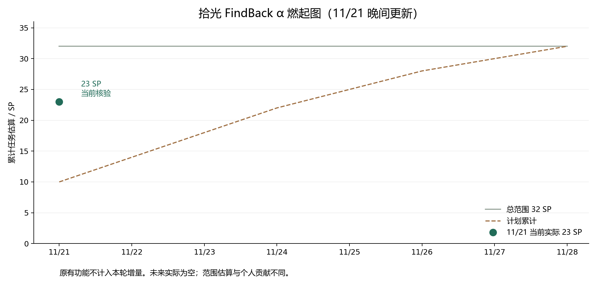

# Gamers2｜拾光 FindBack · 代码规范、任务与八天计划

| 项目 | 内容 |
| --- | --- |
| 所属课程 | [EE308FZ Software Engineering 2026 Fall](https://bbs.csdn.net/forums/2601_MU_SE_FZU) |
| 作业要求 | [Fifth Assignment—Alpha Sprint](https://bbs.csdn.net/topics/620611106) |
| 本文目标 | 明确 α 的增量范围、代码规则和 14 人计划分工 |
| 团队与项目 | Gamers2，课程第 4 组，14 人；校园失物招领系统拾光 FindBack |
| 其他参考 | [代码仓库](https://github.com/Zarvik188/FindBack-Gamers2-Prototype)、[任务列表](https://github.com/Zarvik188/FindBack-Gamers2-Prototype/issues)、[本地运行说明](https://github.com/Zarvik188/FindBack-Gamers2-Prototype#本地启动) |
| 记录状态 | 2026-11-21 整理的计划稿；名单沿用原团队，α 责任重新安排 |

[TOC]

## 1 起点与目标

原型阶段已有前后端和数据库，包含发布、搜索、内容审核、私密认领、人工核验、双向交接和通知。原有 18 项测试作为回归基线，不列为本轮新开发。

本轮目标是让基础流程遇到异常输入时行为明确，让关键权限和状态有自动回归，让每个双日检查点都有可追踪成果。图像语义匹配、校园统一认证、小程序、微信推送及自动图片脱敏仍在本轮范围外。

教师要求计划博客在冲刺开始前发布。本稿整理于 11/21；如果团队此前已经开始冲刺，应保留真实发布时间，并在正文说明计划补录，不回填成更早发布。

## 2 团队代码规范

当前实现使用 HTML/CSS/JavaScript、Node.js ES Modules 和 SQLite。本次参考 JavaScript 的通用规范，并按项目实际约定接口、数据和协作规则。教师列举的 Java 开发手册可供规则分类参考，本系统没有 Java 文件，故不写成执行了 Java 专有规则。Google 的 JavaScript 指南目前标明不再更新，本项目仅参考其中编码约定，规则以本页可执行要求为准。

| 范围 | 本项目约定 | 复核方式 |
| --- | --- | --- |
| 编码与排版 | UTF-8，新增或修改块使用 2 空格缩进，单引号，语句分号 | 代码评审；未将旧版压缩函数一次性重排 |
| 命名与模块 | 变量及函数 camelCase，常量说明含义，使用 const/let、import/export | npm run check 检查语法，命名由评审检查 |
| 职责 | 页面组织交互，服务端负责权限、数据校验和状态转换，数据库适配单独保存 | 变更说明标出所属模块 |
| 接口输入 | 校验类型、范围、日期、长度；页码有限且取整，异常返回明确 4xx | api.test.mjs、alpha.test.mjs |
| 数据库 | 用户输入参数绑定，跨表成组写入使用 batch，失败回滚 | SQL 评审和事务回滚用例 |
| 隐私与权限 | 公共接口过滤核验参考，认领证据按申请者/拾主隔离，管理员不自动取得证据 | 权限测试、响应字段核对 |
| 页面输出 | 用户文本先转义再显示，禁止拼接原始用户 HTML | 代码评审及人工检查 |
| 密码与会话 | 密码带盐 PBKDF2；会话令牌摘要存储，失效和退出后禁止私有操作 | 登录、会话失效用例 |
| 业务状态 | 人工核验后进入交接，双方确认才归还，重复操作保持结果一致 | 状态转换用例 |
| 版本与证据 | Issue 描述验收条件，提交说明关联 Issue，保存测试和页面证据 | 提交链接、TAP 日志与截图 |
| 仓库卫生 | 排除数据库、会话、环境变量、凭据和依赖目录 | 提交前检查 git diff --cached |

以上是本轮采用的规范。语法检查仅检查语法，不等同于 lint、隐私审计或对全部旧代码格式的认证。

### 修改与合入流程

先记录 Issue 的触发和验收标准，再修改最小相关模块。缺陷修复先加入能暴露问题的测试，修改后运行 `npm run check` 和 `npm test`。开发者在自己的实际账号下提交；协作审阅者补充具体意见。合入前核对 `git diff`，在日志中写真实提交人和 commit，不替成员制造提交历史。

建议分支格式 `alpha/A02-pagination`，提交格式 `fix(A02): normalize item pagination`。当前代整理提交作为统一交付提交保留，不据此证明 14 人分别编码。云端业务模块 `site/lib/service.mjs` 与本地 `backend/service.mjs` 同步，部署结果另行验证。

### 完成定义

开发任务有可查看的代码差异、关联 Issue、相关回归和运行证据；测试任务有环境、用例、实际结果和缺陷记录；文档任务有具体文件和核对结果。任务估算完成按验收结果累计，同一成果不在多个任务重复计算。

## 3 α 工作清单

采用 12 个任务、合计 32 SP 的初始估算。SP 只用于本次排期，数值为当前拟定口径，既不是工时，也不是成员贡献比例。首日形成的工具和证据经过核验后计入已完成；关联成员栏仍为计划责任，等待实际接手和复核。

| 任务 | 内容 | 估算 | 目标日期 | 当前状态 |
| --- | --- | --- | --- | --- |
| [A01](https://github.com/Zarvik188/FindBack-Gamers2-Prototype/issues/1) | 代码规范、阶段范围与任务计划 | 2 SP | 2026-11-21 | 首日产物已核验 |
| [A02](https://github.com/Zarvik188/FindBack-Gamers2-Prototype/issues/2) | 修复非整数分页导致的接口 500 | 3 SP | 2026-11-21 | 首日产物已核验 |
| [A03](https://github.com/Zarvik188/FindBack-Gamers2-Prototype/issues/3) | 扩展会话、输入、权限与事务回归 | 3 SP | 2026-11-21 | 首日产物已核验 |
| [A04](https://github.com/Zarvik188/FindBack-Gamers2-Prototype/issues/4) | 真实页面自动操作与截图 | 2 SP | 2026-11-21 | 首日产物已核验 |
| [A05](https://github.com/Zarvik188/FindBack-Gamers2-Prototype/issues/5) | 配置持续集成与语法检查 | 2 SP | 2026-11-21 | 首日产物已核验 |
| [A06](https://github.com/Zarvik188/FindBack-Gamers2-Prototype/issues/6) | 键盘操作和小屏交互复核 | 3 SP | 2026-11-24 | 11/21 提前核验完成 |
| [A07](https://github.com/Zarvik188/FindBack-Gamers2-Prototype/issues/7) | 发布与消息异常路径复核 | 3 SP | 2026-11-24 | 11/21 提前核验完成 |
| [A08](https://github.com/Zarvik188/FindBack-Gamers2-Prototype/issues/8) | 认领竞争和交接状态联调 | 3 SP | 2026-11-26 | 11/21 提前核验完成 |
| [A09](https://github.com/Zarvik188/FindBack-Gamers2-Prototype/issues/9) | 跨浏览器与部署边界验收 | 3 SP | 2026-11-27 | 计划 |
| [A10](https://github.com/Zarvik188/FindBack-Gamers2-Prototype/issues/10) | 测试用例、缺陷与阶段报告 | 2 SP | 2026-11-21 | 首日产物已核验 |
| [A11](https://github.com/Zarvik188/FindBack-Gamers2-Prototype/issues/11) | 四篇双日冲刺日志与燃起图 | 3 SP | 2026-11-28 | 计划 |
| [A12](https://github.com/Zarvik188/FindBack-Gamers2-Prototype/issues/12) | 成员复盘、贡献核对与答辩 | 3 SP | 2026-11-29 | 计划 |

## 4 八天推进安排

| 日期 | 重点 | 当天应留下的材料 |
| --- | --- | --- |
| 11/21 | 核对基线、补规范和测试、修复分页 | 缺陷复现、修复提交、测试日志、首日截图 |
| 11/22 | 团队接手首日产物、逐人记录、首个双日检查点 | 第 1 篇日志、当天燃起图与最新运行画面 |
| 11/23 | 键盘、小屏、发布和消息异常检查 | 问题单、复核截图及相关提交 |
| 11/24 | 处理前两日问题，第二个检查点 | 第 2 篇日志与 Issue/成果映射 |
| 11/25 | 多申请者和重复请求联调 | 状态测试、缺陷与修复 |
| 11/26 | 完成第三个检查点 | 第 3 篇日志及最新测试结果 |
| 11/27 | 第二浏览器、干净环境运行复核 | 兼容矩阵、运行步骤、环境差异 |
| 11/28 | 最终回归、第四篇日志、总结和演练 | 第 4 篇日志、最终测试、成员复盘和 PPT |
| 11/29 | 检查全部博客和附件、课程提交 | 正式链接、审核状态、课程提交凭据 |

这是团队发布与推进安排；教师明确给出八天范围和每两天一篇，并未逐篇指定具体钟点。建议双日当晚完成发布，为审核和修改留出时间。

## 5 成员计划分工

以下由原 14 人名单重新安排 α 任务，等待团队执行。它不表示表中成员已完成列出的事项，也不沿用原型作业的贡献百分比。开发成员须补本人实际提交，测试和文档成员须补具体成果。

| 学号 | 成员 | α 阶段计划任务 | 关联任务 | 应保留成果 |
| --- | --- | --- | --- | --- |
| 832401315 | Sun Zikun | 统筹 8 天排期、检查每篇日志和总目录 | A01、A11、A12 | 排期版本、日志核对表、真实协调记录 |
| 832401313 | Luo Yuhan | 后端分页修复、持续集成及源码归档 | A02、A05 | 代码提交、工作流结果和版本收据 |
| 832401329 | Zhou Debin | 需求与 Issue 对应、范围变更记录、日志整理 | A01、A11 | 需求追踪表、范围变更理由 |
| 832401327 | Zheng Ziyang | 发布、审核拒绝等异常规则与缺陷整理 | A07、A10 | 异常用例、缺陷复现步骤与回归结论 |
| 832401223 | Wu Junjia | 键盘与弹窗交互复核、PPT 和课堂演示 | A06、A12 | 交互复核记录、PPT、实际演练记录 |
| 832401328 | Zheng Zongyuan | 广场检索、小屏布局及截图核对 | A04、A06 | 检索与小屏操作记录、截图 |
| 832401230 | Zuo Xiangrong | 认领表单、交接展示与状态联调 | A04、A08 | 认领和交接截图、问题单 |
| 832401210 | Li Jianhang | 发布和消息异常场景、双日日志素材 | A07、A11 | 发布与消息复核单、当期素材 |
| 832401213 | Liu Peikun | 接口评审、测试与 CI 检查、认领联调 | A02、A03、A05、A08 | 评审意见、相关提交与测试证据 |
| 832401317 | Wang Qiushi | 认领竞争、重复请求和双向确认规则 | A03、A08 | 状态用例与联调记录 |
| 832401318 | Xiao Zhengyu | 会话失效、通知隔离和权限检查 | A03、A07 | 会话和通知测试输出 |
| 832401212 | Liu Junye | 功能边界、跨环境验收记录及下一阶段范围 | A09、A12 | 环境差异记录、下一阶段清单 |
| 832401319 | Xu Yichao | 回归用例、浏览器检查与测试报告 | A03、A09、A10 | 测试用例表、原始日志和报告 |
| 832401330 | Zhou Shengdong | 浏览器兼容、小屏复核及材料一致性 | A06、A09 | 兼容矩阵、链接与材料核对表 |

## 6 进度与风险

燃起图同时显示总范围、计划累计和实际累计。首日实际为 23/32 SP，来自规范、分页修复、扩展回归、页面截图、CI、交互复核、异常反馈、状态联调和测试报告九项成果。未来实际值为空；计划曲线不能当作完成曲线。如果增删范围，先更新任务清单和总范围，再说明变化原因。

主要风险是双日日志缺证据、计划责任误写为实际工作、云端与本地版本不同，以及将同一浏览器的两个视口误写为跨浏览器测试。每个检查点先核对成果，再写完成结论。公开演示环境使用教学数据。

## 7 参考资料

- [Google JavaScript Style Guide](https://google.github.io/styleguide/jsguide.html)
- [Node.js 24 Test runner](https://nodejs.org/docs/latest-v24.x/api/test.html)
- [Playwright Library](https://playwright.dev/docs/library)
- [GitHub Actions workflow triggers](https://docs.github.com/en/actions/how-tos/write-workflows/choose-when-workflows-run/trigger-a-workflow)
