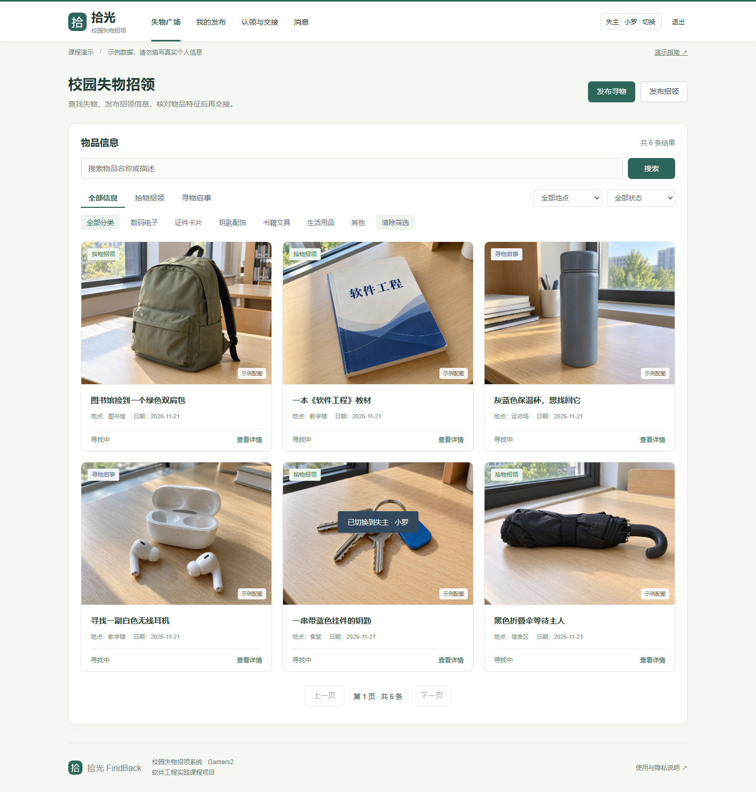
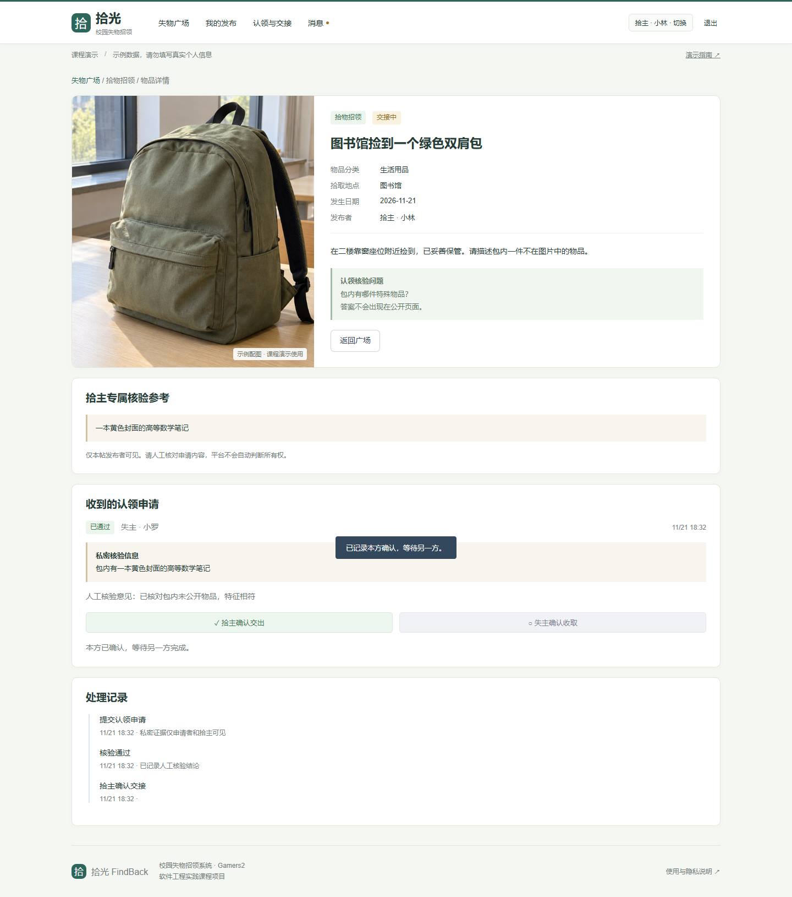
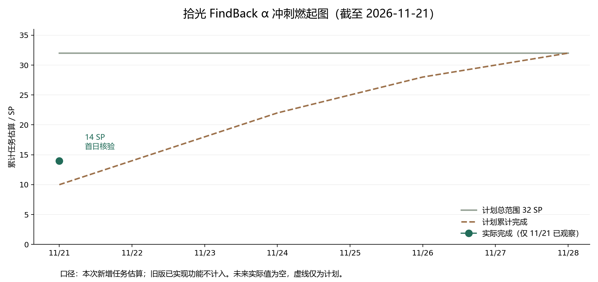

# Gamers2｜拾光 FindBack · 冲刺日志一：基线与边界回归

| 项目 | 内容 |
| --- | --- |
| 所属课程 | [EE308FZ Software Engineering 2026 Fall](https://bbs.csdn.net/forums/2601_MU_SE_FZU) |
| 作业要求 | [Fifth Assignment—Alpha Sprint](https://bbs.csdn.net/topics/620611106) |
| 本文目标 | 记录 11/21—22 的实际工作、成果和阻碍 |
| 团队与项目 | Gamers2，课程第 4 组，14 人；校园失物招领系统拾光 FindBack |
| 其他参考 | [代码仓库](https://github.com/Zarvik188/FindBack-Gamers2-Prototype)、[任务列表](https://github.com/Zarvik188/FindBack-Gamers2-Prototype/issues)、[本地运行说明](https://github.com/Zarvik188/FindBack-Gamers2-Prototype#本地启动) |
| 记录状态 | 截至 11/21 的首日记录；11/22 尚未发生，本篇待补齐再作为双日日志发布 |

[TOC]

## 1 本次检查点

本轮从原型阶段的基础实现开始，首先重新运行原有 18 项接口测试，确认基线可用。随后补充输入边界、会话失效、第三方权限和事务回滚检查。11 月 21 日完成分页修复、8 项新增接口测试和真实页面自动操作。

## 2 计划与实际

| 工作 | 首日实际成果 | 证据 |
| --- | --- | --- |
| 规范和任务 | 形成 12 项、32 SP 的 α 范围及 14 人计划责任 | [A01](https://github.com/Zarvik188/FindBack-Gamers2-Prototype/issues/1)、计划博客 |
| 分页缺陷 | 复现小数页码导致 HTTP 500，修复取整和非有限值回退 | [A02](https://github.com/Zarvik188/FindBack-Gamers2-Prototype/issues/2)、[221c212](https://github.com/Zarvik188/FindBack-Gamers2-Prototype/commit/221c212e6b5c27d4d35bf40c48ac901e53e110cf) |
| 自动回归 | 原有 18 项加新增 8 项，26 项通过 | [A03](https://github.com/Zarvik188/FindBack-Gamers2-Prototype/issues/3)、[原始 TAP](../evidence/2026-11-21/api-tests.tap) |
| 浏览器检查 | 6 项通过，保存 6 张当前运行截图 | [A04](https://github.com/Zarvik188/FindBack-Gamers2-Prototype/issues/4)、[页面报告](../evidence/2026-11-21/browser-report.json) |
| 自动化配置 | 增加语法检查命令与 Node 24 工作流配置 | [A05](https://github.com/Zarvik188/FindBack-Gamers2-Prototype/issues/5)、工作流文件；[GitHub Actions 已通过](https://github.com/Zarvik188/FindBack-Gamers2-Prototype/actions/runs/44895351654) |
| 测试文档 | 整理 26 项用例和首日阶段报告 | [A10](https://github.com/Zarvik188/FindBack-Gamers2-Prototype/issues/10)、测试博客和用例文档 |

这些是本次整理及运行中产生的实际成果。它们由统一账号归档，不拆写成 14 位成员各自完成的开发记录。团队按计划接手后的逐人结果应附本人提交或具体成果。

## 3 一处真实缺陷如何处理

旧实现将页码转换为数字后直接计算 OFFSET。请求 `/api/items?page=1.1` 得到非整数偏移，SQLite 报 `datatype mismatch`，接口返回 500。新增测试先在旧代码上失败，再将有限页码向下取整并限制在 1—10000，非法或无限数值统一回到第 1 页。修改后新增 8 项与原 18 项全部通过。

`page=Infinity` 的回退行为是本轮明确的新约定，旧实现将它限制为 10000；这项与真正复现的 500 缺陷分别记录，避免把合同变化也称为崩溃。

## 4 最新运行画面

下图为 11/21 使用独立 SQLite 演示库实际运行的页面，六件物品属于课程示例。

## 5 项目燃起图

初始总范围 32 SP，首日已核验产物 14 SP。仅 11/21 有实际值。既有系统功能不计为本次增量，未来日期也不提前填入实际完成值。

## 6 每位成员的本期记录

计划分工见计划博客。首日尚未取得个人工作记录，下表供本双日结束时逐人回填。未提交记录不推定“零贡献”，也不能记为“已完成”。

| 成员 | 关联计划任务 | 本期实际完成 | Issue / commit / 具体成果 |
| --- | --- | --- | --- |
| Sun Zikun | A01、A11、A12 | 待成员提供实际记录 | 待补 |
| Luo Yuhan | A02、A05 | 待成员提供实际记录 | 待补 |
| Zhou Debin | A01、A11 | 待成员提供实际记录 | 待补 |
| Zheng Ziyang | A07、A10 | 待成员提供实际记录 | 待补 |
| Wu Junjia | A06、A12 | 待成员提供实际记录 | 待补 |
| Zheng Zongyuan | A04、A06 | 待成员提供实际记录 | 待补 |
| Zuo Xiangrong | A04、A08 | 待成员提供实际记录 | 待补 |
| Li Jianhang | A07、A11 | 待成员提供实际记录 | 待补 |
| Liu Peikun | A02、A03、A05、A08 | 待成员提供实际记录 | 待补 |
| Wang Qiushi | A03、A08 | 待成员提供实际记录 | 待补 |
| Xiao Zhengyu | A03、A07 | 待成员提供实际记录 | 待补 |
| Liu Junye | A09、A12 | 待成员提供实际记录 | 待补 |
| Xu Yichao | A03、A09、A10 | 待成员提供实际记录 | 待补 |
| Zhou Shengdong | A06、A09 | 待成员提供实际记录 | 待补 |

## 7 阻碍与下一步

现有测试通过只能说明列出的本地场景符合预期。第二浏览器、真实部署、负载和校园使用尚未验证。11/22 先由成员确认职责、复核首日产物，补入当天工作与最新截图，再完成本篇双日记录。GitHub Actions 已实际执行完成，语法检查与接口测试均通过：[GitHub Actions 已通过](https://github.com/Zarvik188/FindBack-Gamers2-Prototype/actions/runs/44895351654)。

## 8 11/22 补录区

待填写当天实际执行的工作、完成和未完成原因、成员成果链接、当天燃起图以及最新运行画面。此区未补齐前，本篇只是首日阶段稿。
