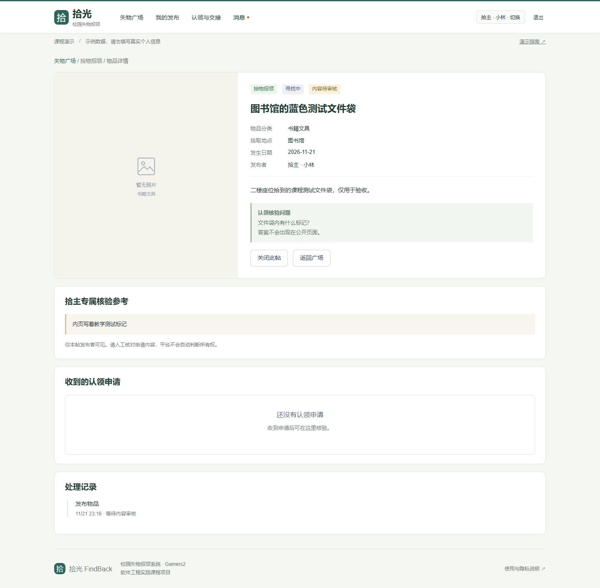
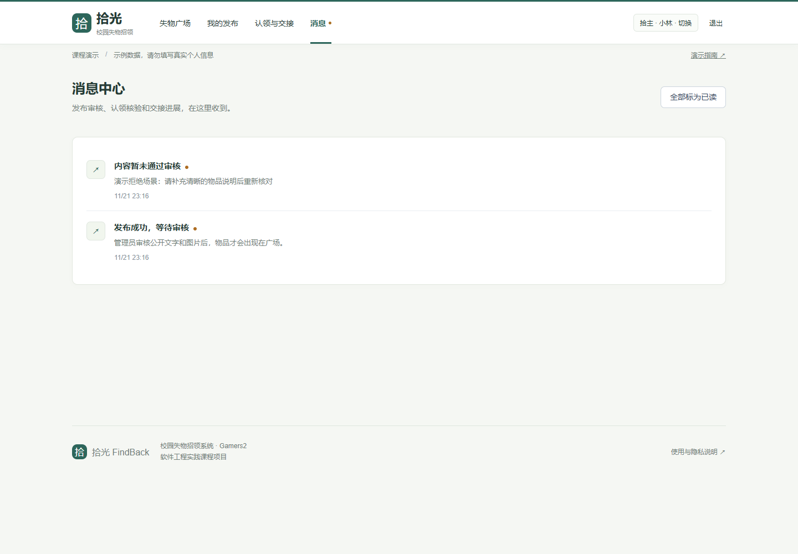
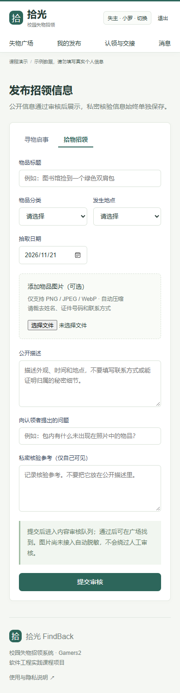
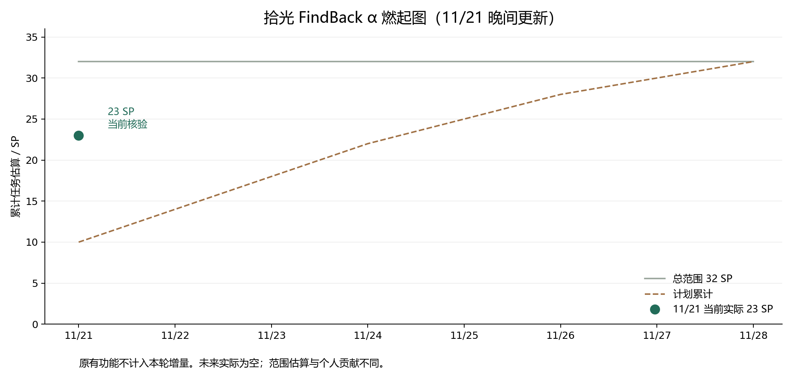

# Gamers2｜拾光 FindBack · 冲刺日志二：键盘、小屏和异常反馈

| 项目 | 内容 |
| --- | --- |
| 所属课程 | [EE308FZ Software Engineering 2026 Fall](https://bbs.csdn.net/forums/2601_MU_SE_FZU) |
| 作业要求 | [Fifth Assignment—Alpha Sprint](https://bbs.csdn.net/topics/620611106) |
| 本文目标 | 记录 11/23—11/24 的团队冲刺成果 |
| 团队与项目 | Gamers2，课程第 4 组，14 人；校园失物招领系统拾光 FindBack |
| 其他参考 | [代码仓库](https://github.com/Zarvik188/FindBack-Gamers2-Prototype)、[任务列表](https://github.com/Zarvik188/FindBack-Gamers2-Prototype/issues)、[本地运行说明](https://github.com/Zarvik188/FindBack-Gamers2-Prototype#本地启动) |
| 记录状态 | 完整预写稿；计划发布 11/24，引用的提前检查实际执行于 11/21 |

[TOC]

> 证据日期说明：本文引用的运行、测试和归档工作均实际执行于 2026-11-21。双日日期表示作业安排的发布窗口。本稿已补成技术正文，正式发布时仍应核对该窗口新增成果；没有把未来日期或 14 人各自工作写成已经发生。

## 1 交互检查要覆盖中间状态

这一篇围绕登录、发布和消息反馈展开。检查从键盘进入登录开始，使用 Enter 打开弹窗，再用 Escape 关闭；随后尝试提交空的发布表单。浏览器正确指出标题必填，页面仍保留表单，没有生成一条空物品记录。

这类检查能说明所测控件的行为，但不能据此宣称完成整个站点的无障碍认证。完整的读屏、焦点顺序和更多设备仍应分别安排。

## 2 待审核和拒绝反馈

页面实际发布一条教学测试文件袋。提交后，发布者看到“内容待审核”；内容管理员拒绝这条记录并填写原因后，匿名搜索结果不出现该物品。发布者在消息中心收到同一条审核原因。

这一结果把三个位置连接起来：发布成功表示系统保存了内容，公开展示还需审核；拒绝后不能继续出现在公共列表；审核意见应回到发布者能够找到的位置。

## 3 空消息、小屏和会话失效

全新的失主身份在消息中心看到“还没有消息”，能分辨没有数据和页面加载失败。390px 视口下分别打开发布表单和物品详情，所测页面没有水平溢出。测试最后使会话过期，再打开消息页，页面明确提示重新登录，并恢复登录入口。

这些检查使用同一台本地 Edge。两个视口不是两个浏览器，也不代表覆盖所有机型。

## 4 结果、任务和证据

扩展页面脚本的 9 项检查通过，对应 [A06](https://github.com/Zarvik188/FindBack-Gamers2-Prototype/issues/6) 和 [A07](https://github.com/Zarvik188/FindBack-Gamers2-Prototype/issues/7)。完整环境、项目和执行时间见 [页面报告](../evidence/2026-11-21/extended/extended-ui-report.json)，操作保存在 `alpha/scripts/check-ui-stage.cjs`。另有首轮 6 项主流程检查，合计 15 项页面场景。

页面测试脚本最初出现过定位器同时匹配 meta 与 textarea 的情况，已将发布描述字段限定为 textarea 后重跑。这是测试脚本定位问题，没有写成产品功能缺陷。

## 5 燃起图与成员核对

总范围 32 SP，当前经核验的任务 23 SP。新增的 9 SP 来自交互复核、发布消息异常路径和认领状态联调，均在 11/21 执行。后续实际列仍为空，计划线不作为完成记录。

界面与异常方向由 Wu Junjia、Zheng Zongyuan、Li Jianhang、Zheng Ziyang、Xiao Zhengyu 和 Zhou Shengdong 按计划复核，其他成员也按总分工表交叉检查自己关联的输入、权限与反馈。这里列出的是责任安排，实际参与情况以本人确认及成果为准。

## 6 本阶段认识

用户不只需要知道按钮点成功了，还需要知道内容有没有公开、为什么被拒绝、是不是没有消息、是否还保持登录。把这些反馈写成可重复操作，能让界面和服务端规则一起接受检查。正式发布前，再结合 11/23—24 的实际新增修改更新截图和差异。
