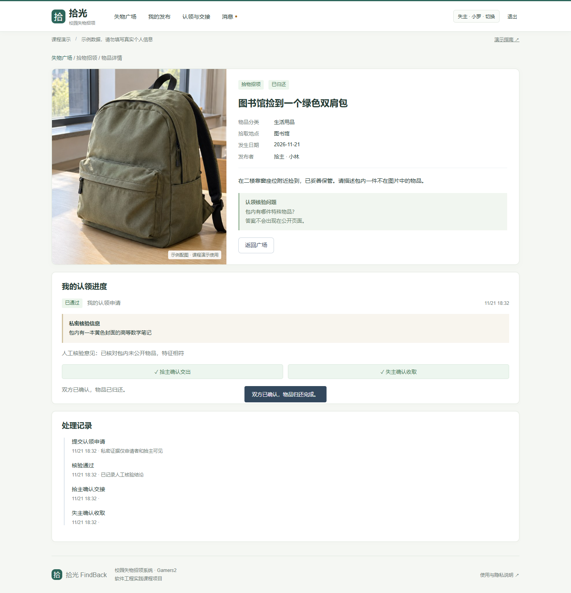

# Gamers2｜拾光 FindBack · 冲刺日志三：认领与交接联调

| 项目 | 内容 |
| --- | --- |
| 所属课程 | [EE308FZ Software Engineering 2026 Fall](https://bbs.csdn.net/forums/2601_MU_SE_FZU) |
| 作业要求 | [Fifth Assignment—Alpha Sprint](https://bbs.csdn.net/topics/620611106) |
| 本文目标 | 记录 11/25—11/26 的团队冲刺成果 |
| 团队与项目 | Gamers2，课程第 4 组，14 人；校园失物招领系统拾光 FindBack |
| 其他参考 | [代码仓库](https://github.com/Zarvik188/FindBack-Gamers2-Prototype)、[任务列表](https://github.com/Zarvik188/FindBack-Gamers2-Prototype/issues)、[本地运行说明](https://github.com/Zarvik188/FindBack-Gamers2-Prototype#本地启动) |
| 记录状态 | 完整预写稿；计划发布 11/26，引用的状态回归实际执行于 11/21 |

[TOC]

> 证据日期说明：本文引用的运行、测试和归档工作均实际执行于 2026-11-21。双日日期表示作业安排的发布窗口。本稿已补成技术正文，正式发布时仍应核对该窗口新增成果；没有把未来日期或 14 人各自工作写成已经发生。

## 1 交接不能依赖固定点击顺序

基础演示采用拾主先确认、失主后确认。实际使用也可能由失主先点击收到，因此本次补充反向确认：失主先确认后仍保持交接中，重复点击不提前结案，拾主确认后才变为已归还；结案后再次点击也保持同一结果。

这一检查说明交接规则对所测的两种顺序成立。接口维护双方确认字段和物品状态，页面只展示服务端结论。

## 2 两个核验请求重叠到达

为同一物品建立两个申请，再用 `Promise.all` 发起两个重叠的通过请求。观察到一个请求返回 200，另一个返回 409；数据库中恰好一个申请 approved、一个 rejected，物品的 active_claim_id 指向批准的申请。

同时检查状态和关联关系，比只统计成功返回更严格。该场景是在本地同进程中受控重叠执行，并非多机、高负载或生产数据库压力测试。

## 3 核验后的非法状态转换

申请通过后，物品已进入交接阶段。再次尝试关闭物品或将同一申请改判拒绝，接口均返回 409，物品仍保持交接中。避免在已有有效交接时通过另一条操作把流程跳回去。

新增 3 项对应 [A08](https://github.com/Zarvik188/FindBack-Gamers2-Prototype/issues/8)，[提交 3e9d129](https://github.com/Zarvik188/FindBack-Gamers2-Prototype/commit/3e9d129)。当前总计 29 项接口回归全部通过；原先 26 项结果保留为历史检查点，最新结果以 [29 项 TAP](../evidence/2026-11-21/extended/api-tests-29.tap) 为准。

## 4 状态的实际页面

画面来自首轮真实操作，日期为 11/21。新增的反向与重叠请求以自动测试输出为证据，不把截图说成压力测试结果。

## 5 燃起图与协作

总范围 32 SP，当前经核验的任务 23 SP。新增的 9 SP 来自交互复核、发布消息异常路径和认领状态联调，均在 11/21 执行。后续实际列仍为空，计划线不作为完成记录。

Wang Qiushi、Zuo Xiangrong、Liu Peikun 按计划负责状态联调，Luo Yuhan 和 Xu Yichao 复核接口与回归，其他成员按自己的责任方向核对展示、通知及文档。实际编码归属仍以真实提交为准，统一协助产生的提交不拆成多人开发历史。

## 6 阶段体会

状态测试要关注尚未完成的时候是否正确。单方确认不能结案、重复操作不能造成新结果、竞争者不能同时成为有效认领，这些约束共同支撑最终“已归还”的含义。11/25—26 正式检查点应继续加入届时真实发生的联调差异和未解决问题。
