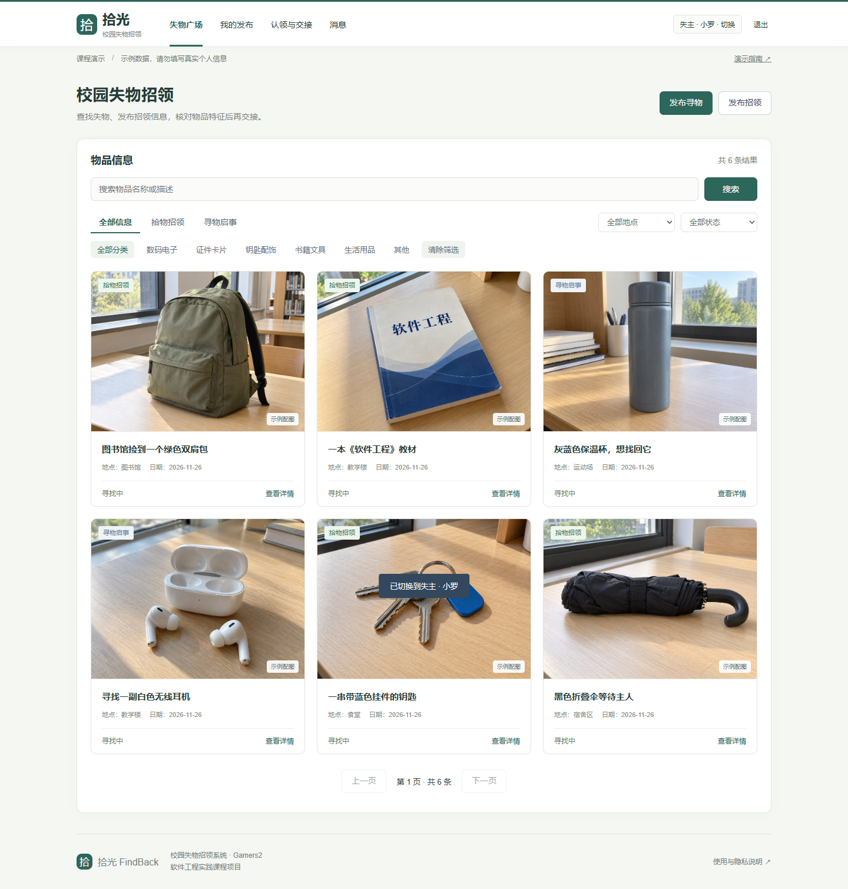
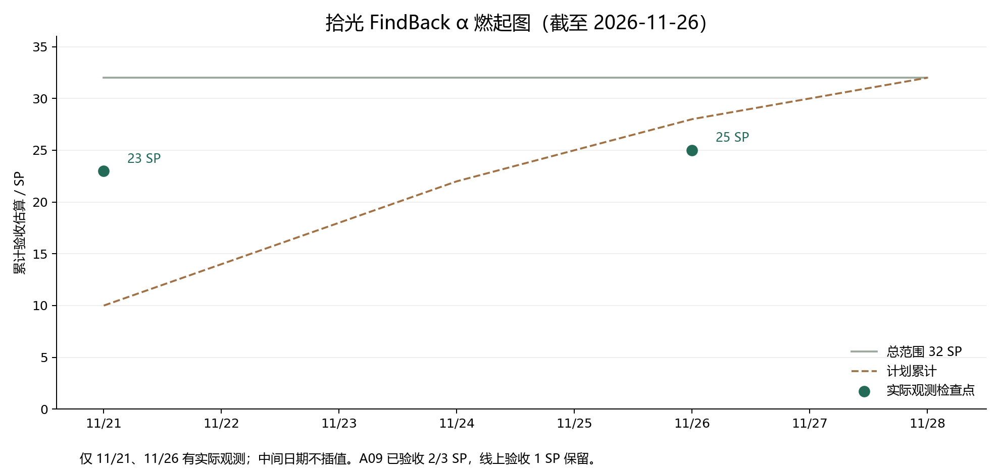

# Gamers2｜拾光 FindBack · 冲刺日志三：状态回归与跨浏览器验收

| 项目 | 内容 |
| --- | --- |
| 所属课程 | [EE308FZ Software Engineering 2026 Fall](https://bbs.csdn.net/forums/2601_MU_SE_FZU) |
| 作业要求 | [Fifth Assignment—Alpha Sprint](https://bbs.csdn.net/topics/620611106) |
| 本文目标 | 记录 11/25—11/26 的团队冲刺成果 |
| 团队与项目 | Gamers2，课程第 4 组，14 人；校园失物招领系统拾光 FindBack |
| 其他参考 | [代码仓库](https://github.com/Zarvik188/FindBack-Gamers2-Prototype)、[任务列表](https://github.com/Zarvik188/FindBack-Gamers2-Prototype/issues)、[本地运行说明](https://github.com/Zarvik188/FindBack-Gamers2-Prototype#本地启动) |
| 记录状态 | 11/26 实测更新稿；按第三阶段整理，未声称 11/25 有单独执行记录 |

[TOC]

## 1 阶段目标与工作衔接

前两阶段围绕基础输入、界面反馈和交接规则整理。这一阶段继续检查系统在另一种浏览器内核、全新数据库以及重新打包后的行为。原有状态测试保留，今天重跑后再补环境验收，避免只依赖 11/21 的结果。

本阶段重点是状态回归、跨浏览器和环境验收；新增结果见本篇附件。阶段工作按可核验成果汇总，个人记录另行确认。现有提交来自当前归档账号，个人开发、测试与文档工作仍按本人真实成果核对。

## 2 状态和接口回归

今天重新执行 29 项接口测试，分页、权限、私密字段、审核、竞争认领及双向交接均通过。其中反向确认保证失主先确认时仍保持交接中，重复点击不会提前结案；重叠核验只有一个有效申请，物品关联到获批申请；进入交接后不能重复改判或直接关闭。

这些规则的原有提交为 [3e9d129](https://github.com/Zarvik188/FindBack-Gamers2-Prototype/commit/3e9d129)，今天重新验证，未把旧功能当作新开发。受控重叠请求是同进程场景，不是生产压力测试。

新增 1 项部署准备回归，在临时目录执行 `prepare-site.mjs`，确认生成的路由具有真实换行、语法检查通过，并保持传入的项目标识。当前自动测试共 30 项：29 项接口、1 项部署准备，全部通过。

[最新自动测试原始日志](../evidence/2026-11-26/automated-tests.tap)。

## 3 Edge 与 Firefox 使用相同的页面场景

| 浏览器 | 内核/版本 | 主流程 | 扩展交互 | 结果 |
| --- | --- | --- | --- | --- |
| edge | chromium / 158.0.4370.33 | 6 项 | 9 项 | 15/15 通过 |
| firefox | firefox / 153.0 | 6 项 | 9 项 | 15/15 通过 |

两种浏览器各执行相同的 15 个场景，合计 30 次页面场景执行。主流程包括搜索、私密认领、单方确认和双方归还；扩展部分包括键盘打开/关闭弹窗、空表单、待审核、拒绝通知、空消息、小屏表单/详情以及会话失效。

Edge 158.0.4370.33 与 Firefox 153.0 属于不同内核。桌面视口与 390px 小屏均保存截图，这次可以给出所测场景的跨浏览器结论。该结论仍不覆盖 Safari、真实手机触摸行为或全部设备。

[Edge 主流程](../evidence/2026-11-26/edge/main/browser-report.json)、[Edge 扩展](../evidence/2026-11-26/edge/extended/extended-ui-report.json)、[Firefox 主流程](../evidence/2026-11-26/firefox/main/browser-report.json)、[Firefox 扩展](../evidence/2026-11-26/firefox/extended/extended-ui-report.json)。

## 4 从干净源码包启动

从已提交版本导出仅含运行所需文件的源码，解压到临时目录，不带 node_modules、现有数据库或日常演示数据。标准模式下服务成功启动，自动建立空数据库，演示管理员入口被关闭。

随后注册合成账号、发布测试物品，确认待审核内容对发布者可见、匿名不可见。停止并重启服务后，账号、物品和审核状态仍保留。HTML、JS、CSS 和示例图片均可读取，后端源码不能作为静态资源获取。

7 项干净包检查通过，见 [独立报告](../evidence/2026-11-26/clean-release.json)。该结果是本机干净目录运行，不是云端部署或备份恢复演练。

## 5 部署边界与进度

本地业务模块、前端页面/脚本/样式/图标以及示例图片与部署源码逐文件 SHA-256 相同。现有云端项目在当前 Sites 连接中返回项目未找到，公开健康请求未取得应用响应，所以线上运行版本保持“未验证”。源码相同不能替代运行环境一致性验收。

本次将 A09 的原 3 SP 明确拆为本地/双浏览器/源码验收 2 SP、线上运行验收 1 SP，总范围仍是 32 SP。已有 23 SP 加今天验收的 2 SP，共 25 SP。A09 保持部分完成，线上 1 SP 不计入已完成；正式日志发布、成员复盘和答辩确认也仍保留。

## 6 协作与下一步

状态联调方向由 Wang Qiushi、Zuo Xiangrong、Liu Peikun 按计划复核；环境与材料方向由 Zhou Shengdong、Xu Yichao、Liu Junye 对照本次报告检查。各责任人按分工复核成果。发布时，各成员补本人真实提交或测试/文档成果。

下一阶段优先解决线上环境可访问性、更新第四篇收尾记录，汇总个人确认和正式博客链接。已有证据足以整理今天的测试与验收正文，尚缺的事实单独保留，保留实际完成状态。
