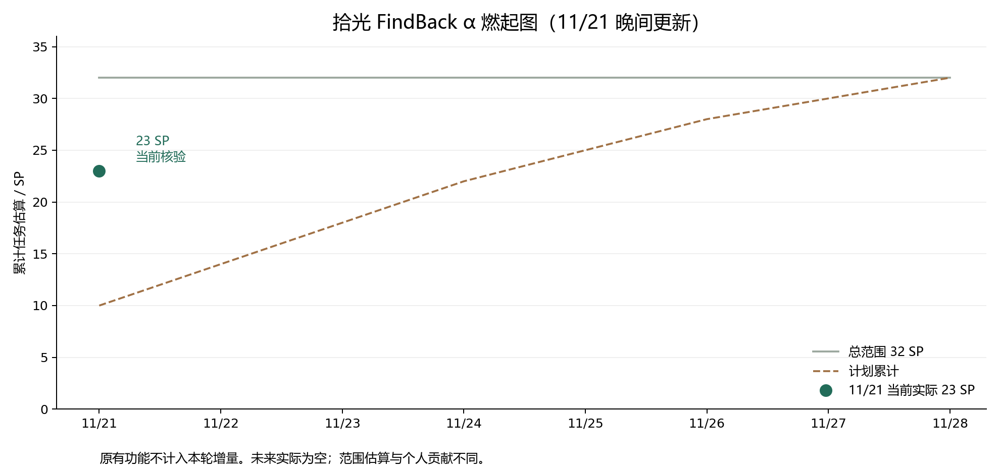
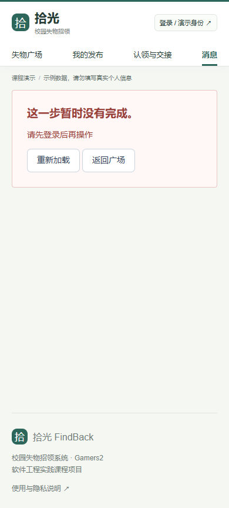

# Gamers2｜拾光 FindBack · 冲刺日志四：环境复核与收尾

| 项目 | 内容 |
| --- | --- |
| 所属课程 | [EE308FZ Software Engineering 2026 Fall](https://bbs.csdn.net/forums/2601_MU_SE_FZU) |
| 作业要求 | [Fifth Assignment—Alpha Sprint](https://bbs.csdn.net/topics/620611106) |
| 本文目标 | 记录 11/27—11/28 的团队冲刺成果 |
| 团队与项目 | Gamers2，课程第 4 组，14 人；校园失物招领系统拾光 FindBack |
| 其他参考 | [代码仓库](https://github.com/Zarvik188/FindBack-Gamers2-Prototype)、[任务列表](https://github.com/Zarvik188/FindBack-Gamers2-Prototype/issues)、[本地运行说明](https://github.com/Zarvik188/FindBack-Gamers2-Prototype#本地启动) |
| 记录状态 | 完整预写稿；计划发布 11/28，当前为 11/21 的交付预检 |

[TOC]

> 证据日期说明：本文引用的运行、测试和归档工作均实际执行于 2026-11-21。双日日期表示作业安排的发布窗口。本稿已补成技术正文，正式发布时仍应核对该窗口新增成果；没有把未来日期或 14 人各自工作写成已经发生。

## 1 收尾先核对版本

本篇整理交付检查的做法和当前已执行结果。源码、博客、测试日志和运行截图放在同一材料包，答辩稿另附可编辑 PPTX 和 PDF 展示版。文稿中的测试数采用 29 项接口、15 项页面场景；原有 26 项与 6 项记录保留为较早检查点。

## 2 附件检查中发现的问题

初次本地 PPTX 导出时，文本正常，图片关系存在，但媒体条目内容为空。只通过结构检查会漏掉这类问题。检查压缩包中的媒体长度并渲染第 6 页后确认缺图，随后改为嵌入实际图片字节，再次导出与复核。

最终 PPTX 保留可编辑文字和图片，PDF 与对应页面逐页核对。该问题属于交付文件生成过程，不能写成校园系统业务缺陷。

## 3 当前检查结论

| 项目 | 当前结果 | 证据 |
| --- | --- | --- |
| 接口回归 | 29 项通过 | extended/api-tests-29.tap |
| 页面检查 | 首轮 6 项、扩展 9 项通过 | 两份浏览器报告 |
| PPTX | 12 页、图片有实际内容、结构及版式检查通过 | PPTX 核验记录与渲染 |
| PDF | 12 页、版式与答辩稿一致 | PDF 展示版 |
| 博客 | 8 篇文件，阶段稿/预写稿标明日期 | 正文与本地预览 |
| 课程发布 | 由团队按各期实际情况发布并提交 | 当前尚无 CSDN 或班级提交凭证 |
| 第二浏览器、真实部署 | 未执行 | 保留为 A09 未完成范围 |

## 4 当前燃起图和运行画面

总范围 32 SP，当前经核验的任务 23 SP。新增的 9 SP 来自交互复核、发布消息异常路径和认领状态联调，均在 11/21 执行。后续实际列仍为空，计划线不作为完成记录。

图片是 11/21 扩展页面检查的实际结果。11/27—28 发布本篇时应增加届时最新画面，保持正式记录与实际日期一致。

## 5 每位成员的收尾工作

| 成员 | 分工方向 | 可据以核对的成果材料 |
| --- | --- | --- |
| Sun Zikun | 排期、范围和双日检查点 | 规范与冲刺计划、tasks.json |
| Luo Yuhan | 接口、持续集成和归档 | 分页修复、29 项回归、CI |
| Zhou Debin | 需求追踪和文稿组织 | 12 项 Issue、范围清单 |
| Zheng Ziyang | 异常规则与缺陷 | 审核拒绝、会话失效记录 |
| Wu Junjia | 交互评审和课堂演示 | 键盘检查、PPTX/PDF |
| Zheng Zongyuan | 检索和小屏页面 | 空结果、390px 页面截图 |
| Zuo Xiangrong | 认领与交接交互 | 单方、双向和反向确认用例 |
| Li Jianhang | 发布和消息 | 待审核、拒绝通知、空消息截图 |
| Liu Peikun | 接口评审与联调 | 服务模块、测试和工作流 |
| Wang Qiushi | 状态与竞争认领 | 重叠核验、重复确认用例 |
| Xiao Zhengyu | 会话与通知隔离 | 过期会话、第三方隔离测试 |
| Liu Junye | 边界与下一阶段 | 未测环境清单、阶段展望 |
| Xu Yichao | 用例和测试报告 | 29 项接口、15 项页面检查 |
| Zhou Shengdong | 兼容与材料一致性 | PPT/PDF、博客和版本核对 |

除各自技术部分外，每位成员还需确认自己的实际成果和参考体会；开发附本人提交，测试和文档附具体结果。统筹汇总正式博客链接，演示负责人用最终附件完整走一次流程，材料复核同学检查版本、数字、图片和下载入口。

## 6 下一阶段

尚未验证的第二浏览器和部署环境先保留为明确缺口。后续优先完成这些验收，再按真实问题调整交互和流程。图像候选匹配、校园认证等扩展另行建立需求和验证，不以当前演示代替上线结论。
