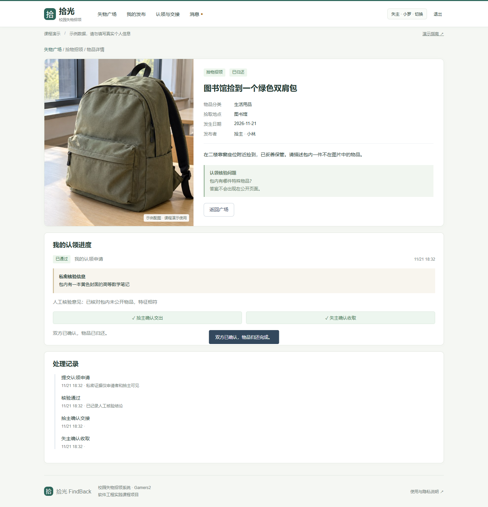
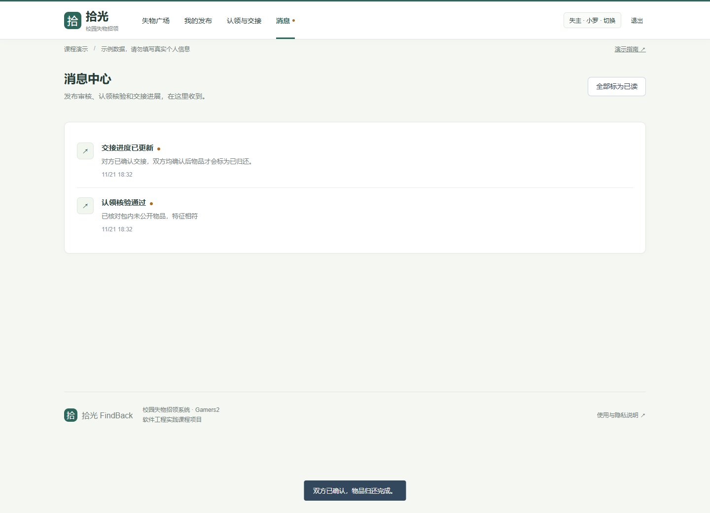

# Gamers2｜拾光 FindBack · α 测试报告

| 项目 | 内容 |
| --- | --- |
| 所属课程 | [EE308FZ Software Engineering 2026 Fall](https://bbs.csdn.net/forums/2601_MU_SE_FZU) |
| 作业要求 | [Fifth Assignment—Alpha Sprint](https://bbs.csdn.net/topics/620611106) |
| 本文目标 | 说明测试安排、工具、用例、实测结果与局限 |
| 团队与项目 | Gamers2，课程第 4 组，14 人；校园失物招领系统拾光 FindBack |
| 其他参考 | [代码仓库](https://github.com/Zarvik188/FindBack-Gamers2-Prototype)、[任务列表](https://github.com/Zarvik188/FindBack-Gamers2-Prototype/issues)、[本地运行说明](https://github.com/Zarvik188/FindBack-Gamers2-Prototype#本地启动) |
| 记录状态 | 11/26 更新的测试阶段报告，保留 11/21 历史结果 |

[TOC]

## 1 测试对象与安排

测试对象是当前可运行的 HTML/JavaScript 前端、Node.js 服务和 SQLite 数据库。重点检查公开数据与私密核验的边界、账号权限、发布审核、认领状态和双向交接。旧版 18 项作为回归基线，本轮累计新增 11 项，避免在加固边界时破坏已有功能。

首轮测试执行于 11/21，本次 11/26 的新结果集中见第 10 节。相关修改后重跑接口测试，11/28 再形成最终回归结论。

## 2 工具选择与实际使用

| 工具 | 为什么使用 | 本次实际应用 |
| --- | --- | --- |
| Node.js node:test + assert/strict | 直接调用现有模块，不额外引入后端依赖 | 29 项接口与数据层回归 |
| SQLite 内存库及临时库 | 隔离测试、避免污染演示数据库 | 每项独立数据库；重开持久化与 batch 回滚 |
| Playwright Library + 已安装 Microsoft Edge | 驱动真实页面操作并保存运行画面 | 15 项页面检查，桌面及 390px 视口 |
| node --check | 在执行前发现 JS 语法错误 | 服务、数据库、HTTP 入口及前端通过 |
| GitHub Actions | 将检查配置与版本一起管理 | 提交 Node 24 工作流；29 项版本已实际通过，[GitHub Actions 已通过](https://github.com/Zarvik188/FindBack-Gamers2-Prototype/actions/runs/44918314810) |

浏览器脚本使用 Library 的定位与等待方法，并使用 `node:assert` 做数据断言，没有配置独立的 Playwright Test 测试工程。小屏检查与桌面检查使用同一个 Edge 浏览器内核。

## 3 环境与复现

- 实测日期：2026-11-21（北京时间）。
- 系统：Windows；Node.js v24.18.0；本地 Edge 157.0.4341.60。
- 桌面视口 1440×1040，小屏视口 390×844。
- 数据：课程示例身份及物品，浏览器脚本自动使用临时 SQLite 文件。
- 对应代码：[221c212](https://github.com/Zarvik188/FindBack-Gamers2-Prototype/commit/221c212e6b5c27d4d35bf40c48ac901e53e110cf)。

```powershell
npm run check
npm test
node --test --test-reporter=tap tests/api.test.mjs tests/alpha.test.mjs
```

页面复现步骤见 `alpha/scripts/运行与取证说明.md`。首次运行浏览器脚本需可用的 Playwright 包及浏览器，可通过环境变量指定路径；正常系统启动不需要这些测试依赖。

## 4 用例与结果

| 测试集合 | 用例数 | 通过 | 失败 | 解释 |
| --- | --- | --- | --- | --- |
| 原型基线接口回归 | 18 | 18 | 0 | 发布、搜索、审核、私密字段、认领、交接、通知和持久化 |
| α 新增接口回归 | 11 | 11 | 0 | 分页、标准模式、会话过期、JSON、体积、第三方权限及事务回滚 |
| 页面场景检查 | 15 | 15 | 0 | 真实 DOM 操作与运行截图，同一浏览器两种视口 |

[完整 29 项用例文档](../test-cases.md)、[最新原始 TAP 日志](../evidence/2026-11-21/extended/api-tests-29.tap)、[浏览器环境与结果](../evidence/2026-11-21/browser-report.json)。用例中的多条断言不重复计数。本次没有测量代码覆盖率，不能把 29/29 解释为覆盖率 100%。

### 新增接口用例

| 新增项 | 预期行为 |
| --- | --- |
| 分页小数 | 1.1、1.01、2.25 返回 200 且页码向下取整 |
| 分页异常 | 非法/非有限值回第 1 页，超大有限值限制为 10000 |
| 标准模式 | DEMO_MODE=false 禁止演示身份入口 |
| 会话过期 | 私有资源返回 401，me 不再返回登录身份 |
| 请求体类型 | 数组、null、字符串和数字为 400，错误媒体类型为 415 |
| 请求体过大 | 超出服务层限制返回 413 |
| 第三方隔离 | 无关用户看不到申请证据及事件，不能确认他人交接 |
| 事务回滚 | 同一 batch 中后条失败，前条写入也被撤销 |

## 5 缺陷记录与回归

[A02](https://github.com/Zarvik188/FindBack-Gamers2-Prototype/issues/2)：旧版 `page=1.1` 触发 SQLite 偏移类型错误，返回 500。新增用例在修改前失败；修复对数字取整并限定范围后通过。`Infinity` 回第 1 页是本轮新定义的输入约定，也有单独测试。

[修改前失败摘要](../evidence/2026-11-21/before-fix.txt)保留原观察与基线；该文件明确标为摘要，不伪装成完整原始日志。修复后的 TAP 为实际命令输出。没有人为制造更多“已解决缺陷”来扩充报告。

## 6 页面观察

真实浏览器完成搜索空结果、提交私密认领、拾主人工核验、拾主确认交出、失主确认收到和消息展示。单方确认保持交接中，双方确认后才显示归还。





## 7 测试体会与评价

原有主流程测试全部通过时，小数页码仍能让服务出错。这说明正常流程可用和边界输入可靠需要分别验证。此次把缺陷的输入写进回归，比只改代码后手工刷新更便于后续重复检查。

权限检查应同时看允许访问的路径和无关用户的路径。页面有“私密”标签并不足够，还要确认接口响应中没有泄露字段。交接检查也不能只看最终归还，需要确认只有一方操作时保持中间状态。

11/21 阶段结果仅支持当时的 Edge 场景；11/26 已补第二浏览器与干净包验收，详见第 10 节。负载、独立安全审计、校园身份和真实用户试用仍未验证。

## 8 参考

- [Node.js 24 Test runner](https://nodejs.org/docs/latest-v24.x/api/test.html)
- [Playwright Library](https://playwright.dev/docs/library)
- [GitHub Actions](https://docs.github.com/en/actions)

## 9 11/21 晚间扩展核验

增加 3 项状态接口回归与 9 项真实页面检查，当前 29 项接口、15 项页面场景全部通过。首轮 26/6 保留为历史；最新接口日志为 [29 项 TAP](../evidence/2026-11-21/extended/api-tests-29.tap)，页面结果为 [9 项扩展报告](../evidence/2026-11-21/extended/extended-ui-report.json)。所测场景仍限本地 Edge，不构成多浏览器或生产验收。

## 10 11/26 复核与验收结果

| 集合 | 结果 | 日期与解释 |
| --- | --- | --- |
| 接口回归 | 29/29 通过 | 11/26 重跑既有接口场景 |
| 部署准备回归 | 1/1 通过 | 临时目录生成路由、检查语法和项目标识保留 |
| 自动测试总计 | 30/30 通过 | 29 接口 + 1 部署准备，不计为 30 项接口 |
| Edge 页面 | 15/15 通过 | Edge 158.0.4370.33，桌面与 390px |
| Firefox 页面 | 15/15 通过 | Firefox 153.0，桌面与 390px |
| 干净源码包 | 7/7 通过 | 无依赖/旧库启动、发布隔离、重启持久化与静态资源边界 |
| 部署源码一致性 | 全部比较文件相同 | SHA-256 逐文件比较，不等于线上运行验证 |
| 线上云端 | 未验证 | 当前 Sites 连接未找到原项目，健康请求未取得应用响应 |

[本次汇总](../evidence/2026-11-26/acceptance-summary.json)、[自动测试](../evidence/2026-11-26/automated-tests.tap)、[干净源码包](../evidence/2026-11-26/clean-release.json)、[源码比对](../evidence/2026-11-26/source-parity.json)。

原文中单一 Edge 的结论属于 11/21 检查点，11/26 已补 Firefox。当前可描述 15 个页面场景在两种内核中执行通过，不能据此描述移动真机、负载、生产安全或校园试用已经完成。
