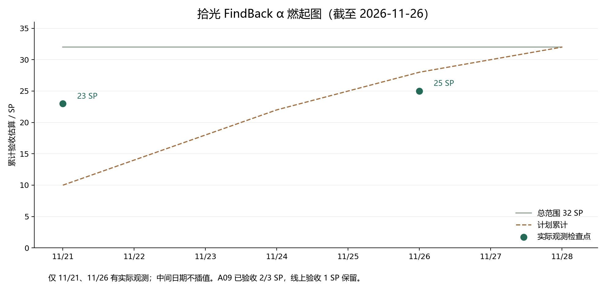

# Gamers2｜拾光 FindBack · α 冲刺总结

| 项目 | 内容 |
| --- | --- |
| 所属课程 | [EE308FZ Software Engineering 2026 Fall](https://bbs.csdn.net/forums/2601_MU_SE_FZU) |
| 作业要求 | [Fifth Assignment—Alpha Sprint](https://bbs.csdn.net/topics/620611106) |
| 本文目标 | 对照计划与实际，记录成员收获、协作及下一阶段 |
| 团队与项目 | Gamers2，课程第 4 组，14 人；校园失物招领系统拾光 FindBack |
| 其他参考 | [代码仓库](https://github.com/Zarvik188/FindBack-Gamers2-Prototype)、[任务列表](https://github.com/Zarvik188/FindBack-Gamers2-Prototype/issues)、[本地运行说明](https://github.com/Zarvik188/FindBack-Gamers2-Prototype#本地启动) |
| 记录状态 | 截至 11/26 的阶段总结；14 人体会仍为成员复盘草稿，待本人确认 |

[TOC]

## 1 预期与实际

本轮希望把原型阶段的基础实现整理成可运行、可重复检查、可追踪的 α 版本。计划分为 12 项任务、32 SP，重点是输入边界、交互异常、认领状态和交付证据。

截至 11/26，分页缺陷修复及 29 项接口回归已复核通过。新增一项部署准备回归后，自动测试共 30 项通过；Edge 与 Firefox 各执行相同的 15 项页面场景，合计 30 次执行通过。规范、Issue、测试报告、完整阶段文稿以及 12 页 PPTX/PDF 一并整理。

业务修复和多数初始验证记录在 11/21，11/26 新增双浏览器、干净源码包和部署准备验证。四篇日志按阶段组织，第三篇已有今天的实测内容，第四篇仍是收尾稿；正式发布需核对日期与成果。14 人个人参与和最终贡献需要本人和团队核对。

## 2 计划差异与完成范围

已完成的九项任务为 23 SP，A09 本地验收部分新增 2 SP，当前累计 25 SP：规范与计划、分页修复、接口扩展、首轮页面、CI 配置、交互复核、发布消息异常、认领联调和测试报告。剩余 7 SP 为线上运行一致性 1 SP、正式双日日志 3 SP、成员复盘和最终答辩确认 3 SP。第二浏览器和干净源码包已经完成。

提前完成了部分原计划在后续阶段检查的技术准备，但没有改变教师要求的双日发布节奏。日期、成员工作、实际成果和计划任务分别记录；写好一篇预稿不等于已经完成那两天的冲刺。

总范围 32 SP，实际检查点为 11/21 的 23 SP 和 11/26 的 25 SP。中间日期未补值；A09 原 3 SP 分解为已完成 2 SP 与线上未验证 1 SP，不变更总范围。

## 3 关键成果与认识

### 输入边界

`page=1.1` 说明一个小参数也能让正常功能返回 500。修复后有限页码取整并限制范围，无效值返回第 1 页。缺陷先通过测试暴露，再通过修复关闭，这个过程使回归具有明确目的。

### 页面反馈

发布后的待审核、审核拒绝的具体原因、空消息和会话失效分别有对应界面检查。390px 的发布和详情页没有水平溢出。页面反馈要让用户能继续操作，而不只是显示成功或失败。

### 状态与权限

单方确认、反向确认、重复点击和重叠核验均有明确检查。只有一个有效认领、双方均确认才归还，构成这版系统的核心约束。证据按角色隔离，公开内容审核与认领核验分别处理。

### 交付一致性

PPTX 导出时的缺图提醒我们，结构检查与真实显示应一起做。最终文件除了检查页数和结构，还要确认媒体有内容、运行图能看到，PDF 与同版答辩稿一致。

## 4 成员体会参考稿

下表围绕本轮分工整理，供成员复核和完善。各成员结合本人实际工作补充具体例子。定稿时由本人确认。

| 成员 | 职责方向 | 体会参考 |
| --- | --- | --- |
| Sun Zikun | 排期、范围和双日检查点 | 统筹时要把“文稿写好”和“已经发布、已经提交”分开检查。一次检查应确认具体链接和版本，不能只在群里问一句做完没有。 |
| Luo Yuhan | 接口、持续集成和归档 | 页码这样的小输入也会影响后端稳定性。修改接口后把原始失败、修复差异和回归结果一起保留，下一次定位问题会更直接。 |
| Zhou Debin | 需求追踪和文稿组织 | 功能清单需要能对应验收条件。把一项任务写成能够检查的行为，比仅写“完善系统”更能帮助团队对齐。 |
| Zheng Ziyang | 异常规则与缺陷 | 异常提示应该让用户知道下一步能做什么。只给一个失败状态码还不够，需要在页面保留明确原因和重新登录入口。 |
| Wu Junjia | 交互评审和课堂演示 | 演示需要解释中间状态，而不仅展示最后成功的页面。单方确认为什么仍在交接中，是比页面好不好看更重要的说明。 |
| Zheng Zongyuan | 检索和小屏页面 | 小屏检查不能只看首页。表单和详情页的信息更密集，应逐页检查操作、横向溢出和文字是否清楚。 |
| Zuo Xiangrong | 认领与交接交互 | 同一个业务过程会有不同操作顺序。交接规则应由状态约束保证，而不是依赖用户刚好按演示顺序点击。 |
| Li Jianhang | 发布和消息 | 发布后等待、审核拒绝和没有消息都需要明确反馈。消息中心要说明发生了什么，也要让用户知道信息与哪件物品有关。 |
| Liu Peikun | 接口评审与联调 | 权限、状态和输入校验应在服务端复核。前端按钮禁用只是交互提示，真正的限制仍要由接口执行。 |
| Wang Qiushi | 状态与竞争认领 | 多申请者场景的关键是只有一个有效认领。测试应核对申请状态和物品所指向的申请，而不只是看接口返回成功。 |
| Xiao Zhengyu | 会话与通知隔离 | 登录状态和资源访问需要一起检查。会话过期后，页面应恢复登录入口，接口也必须拒绝继续访问私有数据。 |
| Liu Junye | 边界与下一阶段 | 下一阶段计划应从当前缺口出发。图像候选匹配、校园认证和部署验收不能只写成已具备能力，需要各自的输入、输出和验证。 |
| Xu Yichao | 用例和测试报告 | 测试通过的结论必须带范围。接口用例数、页面检查数、代码覆盖率和负载能力是不同指标，报告中应分别说明。 |
| Zhou Shengdong | 兼容与材料一致性 | 材料检查也要对应实际版本。截图、图表、测试数字和附件如果来自不同版本，会让已经完成的工作难以被准确理解。 |

## 5 协作与工作量

本轮按统筹、接口、页面、状态、测试和材料分别安排责任。所有工作围绕同一 Issue 的验收条件核对：开发说明修改了什么和如何验证，测试记录输入与实际结果，材料把截图、日志和版本链接连接起来。这样能减少同一问题在代码、页面和博客中出现不同描述的情况。

成员工作量按可核对的成果确认。每位成员以真实提交、评审意见、测试记录或文档作为工作量依据；统筹结合实际投入和协作情况核对，既考虑开发，也考虑测试、审核与材料。SP 表示任务估算，不直接换算个人贡献比例。原型阶段的比例不迁移到本轮。

宿舍协作是上一轮已有的合作方式，本轮可以继续利用沟通便利，但跨宿舍的接口、状态和材料仍需共享同一验收说明。是否采用、实际效果如何，应按本轮真实记录确认。

## 6 已知局限

目前已经有 Edge 158 与 Firefox 153 的两种内核结果，各 15 项页面场景通过。29 项接口和 1 项部署准备回归共 30 项通过，干净源码包 7 项通过。线上云端、压力、安全审计与校园试用仍未验证；通过数不等于代码覆盖率或生产可靠性。

教师要求的正式博客发布、当期实际进展和个人确认尚需按时间完成。没有用空稿占位提交，也没有把 GitHub 上传当作班级作业提交。

## 7 下一阶段与答辩

第二浏览器和干净环境已复核，下一步先确认线上环境并处理实际差异，再考虑校园身份和图像候选匹配。候选匹配用于帮助发现物品，归属仍需私密证据与人工核验。部署、备份、权限与容量分别验收。

答辩由 Wu Junjia 按计划负责演示。现场按首页检索、私密认领、人工核验、单方确认、双方确认和消息依次操作，再说明分页修复、状态回归和燃起图。使用材料包中同版 PPTX/PDF，正式答辩前更新最终进度和个人工作量。

## 8 11/26 阶段补充

本轮新增结果集中在 [第三篇日志](05_冲刺日志三_1125-1126.md)。两种浏览器均通过相同主流程与交互检查，干净源码包关闭演示入口并确认重启持久化。线上服务当前不能验证，A09 不标全部完成。个人体会和工作量仍由本人按实际核对。
