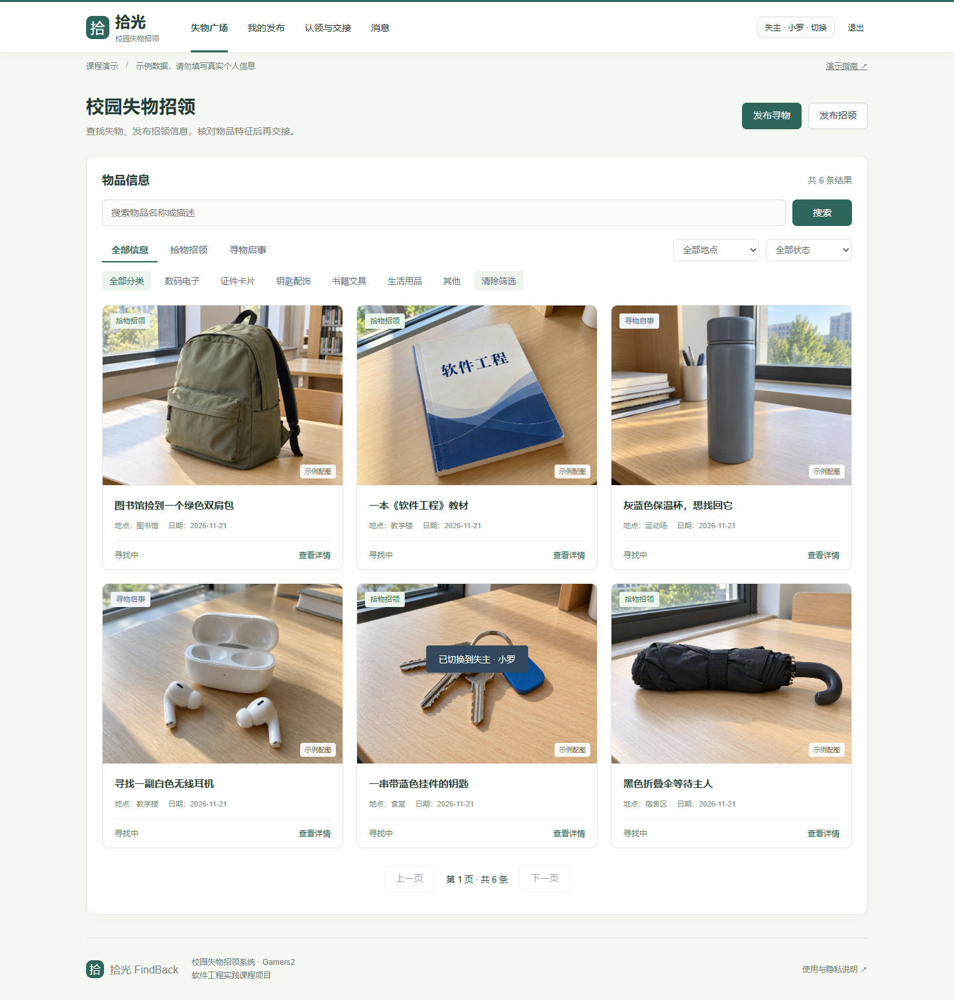
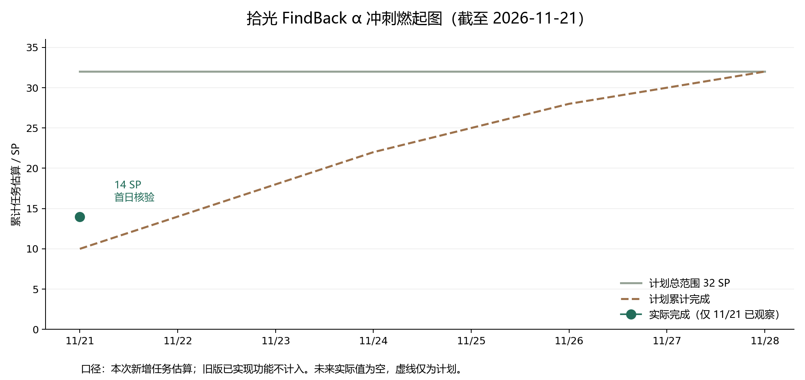

# Gamers2｜拾光 FindBack · α 冲刺总结

| 项目 | 内容 |
| --- | --- |
| 所属课程 | [EE308FZ Software Engineering 2026 Fall](https://bbs.csdn.net/forums/2601_MU_SE_FZU) |
| 作业要求 | [Fifth Assignment—Alpha Sprint](https://bbs.csdn.net/topics/620611106) |
| 本文目标 | 对照计划与实际，记录成员收获、协作及下一阶段 |
| 团队与项目 | Gamers2，课程第 4 组，14 人；校园失物招领系统拾光 FindBack |
| 其他参考 | [代码仓库](https://github.com/Zarvik188/FindBack-Gamers2-Prototype)、[任务列表](https://github.com/Zarvik188/FindBack-Gamers2-Prototype/issues)、[本地运行说明](https://github.com/Zarvik188/FindBack-Gamers2-Prototype#本地启动) |
| 记录状态 | 截至 11/21 的总结准备稿；11/28 结束后补成最终总结 |

[TOC]

## 1 预期计划

本轮用 8 天完成基础版的边界加固、可重复回归、交互与环境复核，持续保留 Issue、提交和运行证据。初始估算为 12 个任务、32 SP。既有发布、认领与交接功能作为基线保留，本轮增量单独记录。

## 2 当前可核验的实际进展

截至 11/21 已形成规范与计划、分页修复、8 项新增接口用例、6 项页面检查及截图、CI 配置和首日测试报告，按初始估算计 14 SP。剩余 18 SP 包括交互异常、状态联调、跨环境复核、四篇双日日志和团队复盘等工作，尚无完成结论。

| 任务 | 内容 | 估算 | 目标日期 | 当前状态 |
| --- | --- | --- | --- | --- |
| [A01](https://github.com/Zarvik188/FindBack-Gamers2-Prototype/issues/1) | 代码规范、阶段范围与任务计划 | 2 SP | 2026-11-21 | 首日产物已核验 |
| [A02](https://github.com/Zarvik188/FindBack-Gamers2-Prototype/issues/2) | 修复非整数分页导致的接口 500 | 3 SP | 2026-11-21 | 首日产物已核验 |
| [A03](https://github.com/Zarvik188/FindBack-Gamers2-Prototype/issues/3) | 扩展会话、输入、权限与事务回归 | 3 SP | 2026-11-21 | 首日产物已核验 |
| [A04](https://github.com/Zarvik188/FindBack-Gamers2-Prototype/issues/4) | 真实页面自动操作与截图 | 2 SP | 2026-11-21 | 首日产物已核验 |
| [A05](https://github.com/Zarvik188/FindBack-Gamers2-Prototype/issues/5) | 配置持续集成与语法检查 | 2 SP | 2026-11-21 | 首日产物已核验 |
| [A06](https://github.com/Zarvik188/FindBack-Gamers2-Prototype/issues/6) | 键盘操作和小屏交互复核 | 3 SP | 2026-11-24 | 计划 |
| [A07](https://github.com/Zarvik188/FindBack-Gamers2-Prototype/issues/7) | 发布与消息异常路径复核 | 3 SP | 2026-11-24 | 计划 |
| [A08](https://github.com/Zarvik188/FindBack-Gamers2-Prototype/issues/8) | 认领竞争和交接状态联调 | 3 SP | 2026-11-26 | 计划 |
| [A09](https://github.com/Zarvik188/FindBack-Gamers2-Prototype/issues/9) | 跨浏览器与部署边界验收 | 3 SP | 2026-11-27 | 计划 |
| [A10](https://github.com/Zarvik188/FindBack-Gamers2-Prototype/issues/10) | 测试用例、缺陷与阶段报告 | 2 SP | 2026-11-21 | 首日产物已核验 |
| [A11](https://github.com/Zarvik188/FindBack-Gamers2-Prototype/issues/11) | 四篇双日冲刺日志与燃起图 | 3 SP | 2026-11-28 | 计划 |
| [A12](https://github.com/Zarvik188/FindBack-Gamers2-Prototype/issues/12) | 成员复盘、贡献核对与答辩 | 3 SP | 2026-11-29 | 计划 |

最终稿应将上表更新为 11/28 的真实状态，对延期、取消和新增任务逐项解释，并附最终版本及运行成果。当前首日情况不能直接作为整轮总结提交。

## 3 运行成果与进度

目前可执行项目和运行说明见 GitHub。最终稿须替换或追加 11/28 的运行画面、最后一次回归和最终燃起图；公开运行地址仅在验证可访问后填写。

## 4 14 位成员的收获和工作量

以下保留原名单，逐人记录本轮真实工作、具体体会和改进。体会应说明一次实际操作或合作及其影响，工作量应与提交、报告或文档成果对应。原型阶段的评价与百分比不迁移为本轮实际贡献。

| 成员 | 计划方向 | 实际工作与证据 | 本人收获与下一步 | 本轮工作量/贡献 |
| --- | --- | --- | --- | --- |
| Sun Zikun | 统筹 8 天排期、检查每篇日志和总目录 | 待本人提供或确认 | 待本人提供或确认 | 待实际核对 |
| Luo Yuhan | 后端分页修复、持续集成及源码归档 | 待本人提供或确认 | 待本人提供或确认 | 待实际核对 |
| Zhou Debin | 需求与 Issue 对应、范围变更记录、日志整理 | 待本人提供或确认 | 待本人提供或确认 | 待实际核对 |
| Zheng Ziyang | 发布、审核拒绝等异常规则与缺陷整理 | 待本人提供或确认 | 待本人提供或确认 | 待实际核对 |
| Wu Junjia | 键盘与弹窗交互复核、PPT 和课堂演示 | 待本人提供或确认 | 待本人提供或确认 | 待实际核对 |
| Zheng Zongyuan | 广场检索、小屏布局及截图核对 | 待本人提供或确认 | 待本人提供或确认 | 待实际核对 |
| Zuo Xiangrong | 认领表单、交接展示与状态联调 | 待本人提供或确认 | 待本人提供或确认 | 待实际核对 |
| Li Jianhang | 发布和消息异常场景、双日日志素材 | 待本人提供或确认 | 待本人提供或确认 | 待实际核对 |
| Liu Peikun | 接口评审、测试与 CI 检查、认领联调 | 待本人提供或确认 | 待本人提供或确认 | 待实际核对 |
| Wang Qiushi | 认领竞争、重复请求和双向确认规则 | 待本人提供或确认 | 待本人提供或确认 | 待实际核对 |
| Xiao Zhengyu | 会话失效、通知隔离和权限检查 | 待本人提供或确认 | 待本人提供或确认 | 待实际核对 |
| Liu Junye | 功能边界、跨环境验收记录及下一阶段范围 | 待本人提供或确认 | 待本人提供或确认 | 待实际核对 |
| Xu Yichao | 回归用例、浏览器检查与测试报告 | 待本人提供或确认 | 待本人提供或确认 | 待实际核对 |
| Zhou Shengdong | 浏览器兼容、小屏复核及材料一致性 | 待本人提供或确认 | 待本人提供或确认 | 待实际核对 |

建议按“完成任务、关联提交/成果、实际投入、协作说明”核对工作量。若课程需要百分比，团队核对后填写，合计 100%。不按 commit 数量机械计分，也不预设每人都应有开发提交；测试和文档应有相应具体成果。

## 5 团队协作

计划由 Sun Zikun 汇总排期，开发、测试和材料负责人按同一 Issue 对齐验收，每两天检查一次。原型阶段曾采用宿舍分工，本轮是否继续及实际效果需按本轮记录说明，不能直接套用上次感受。

待补本轮一次具体协作：谁提出什么问题、双方如何核对、留下什么修改或证据、是否减少返工。未解决的沟通问题也应保留。

## 6 已知问题与下一阶段

当前仍需完成键盘与小屏全流程、发布消息异常、认领联调和第二浏览器复核。最终回顾时按实际执行结果更新这些状态。

下一阶段优先处理 α 遗留的可复现缺陷，再考虑校园身份与运行环境。图像候选匹配即使后续加入，也只用于发现候选，不能代替私密证据核验。生产部署需另行开展权限配置、备份、审计和容量验证，当前测试结果不能替代这些验收。

## 7 答辩安排

沿用 Wu Junjia 的演示责任作为本轮计划，实际演练后确认。演示顺序为首页与搜索、私密认领、人工核验、单方确认、双方确认及消息，再解释新增分页修复、自动回归、燃起图和未完成项。当前演示文稿为首日版，冲刺结束后按最终事实更新。
