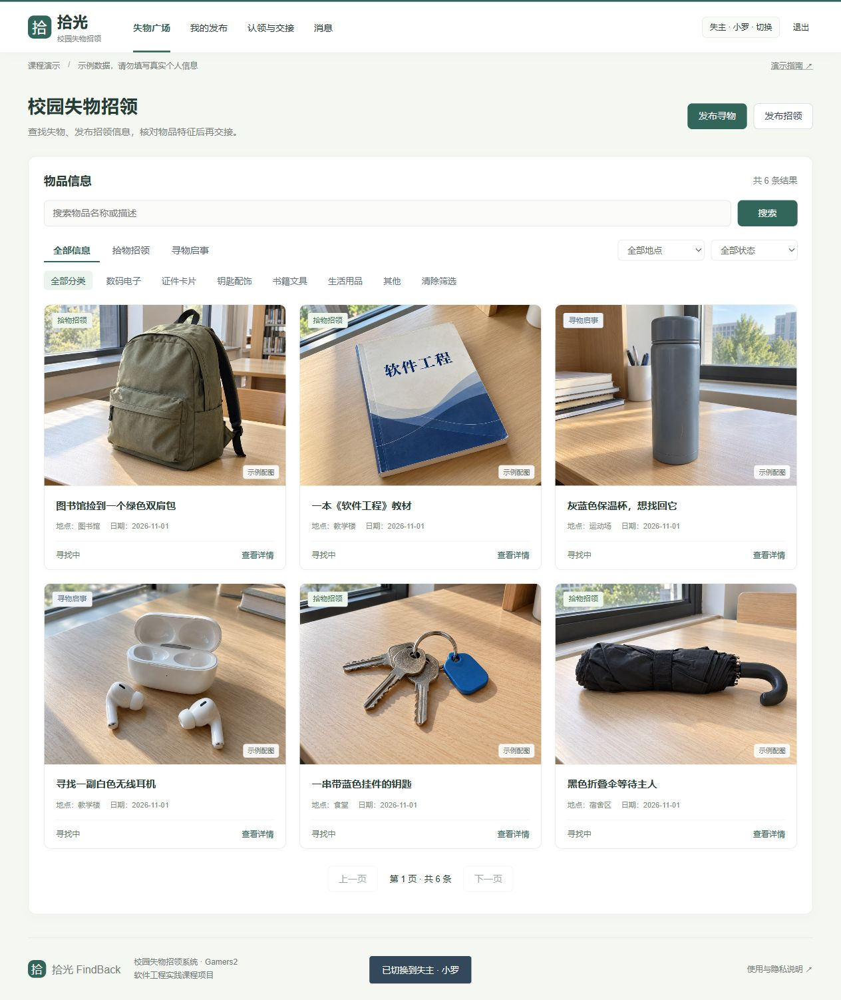
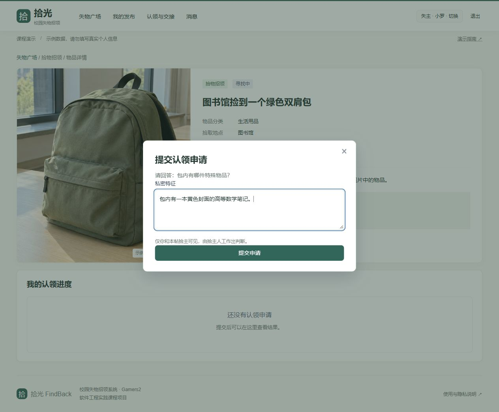
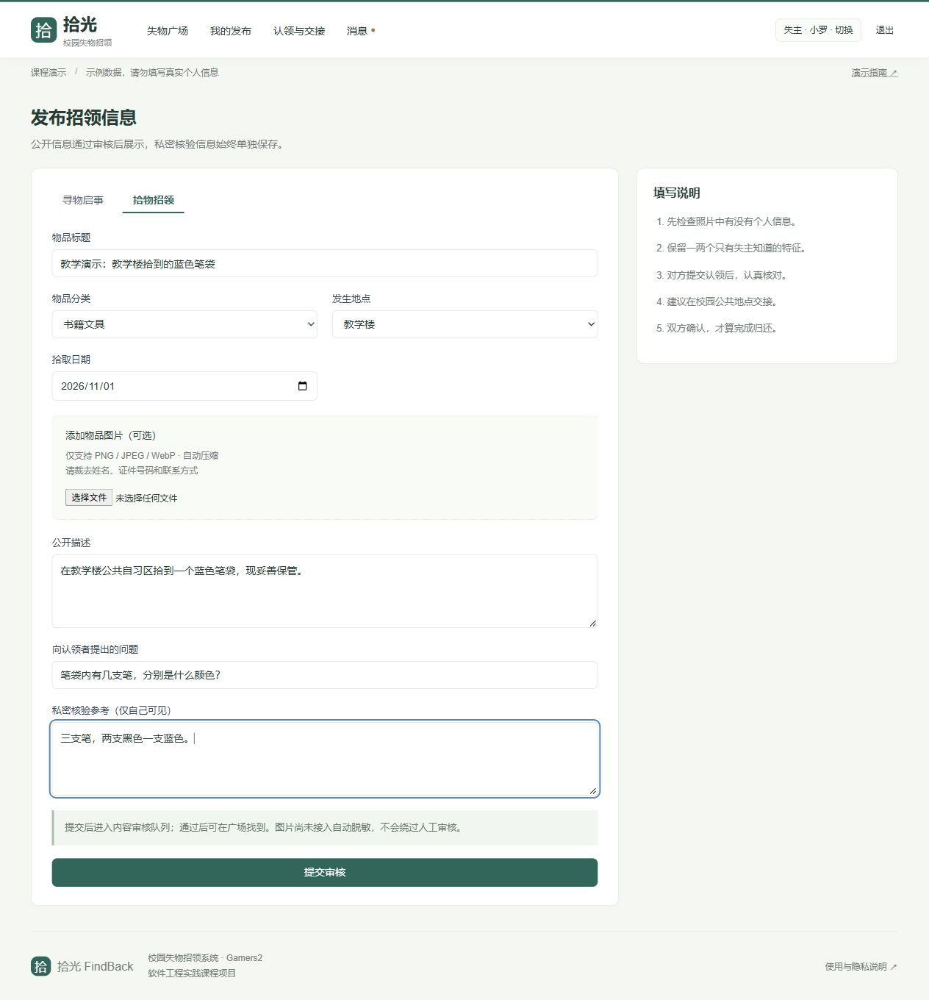
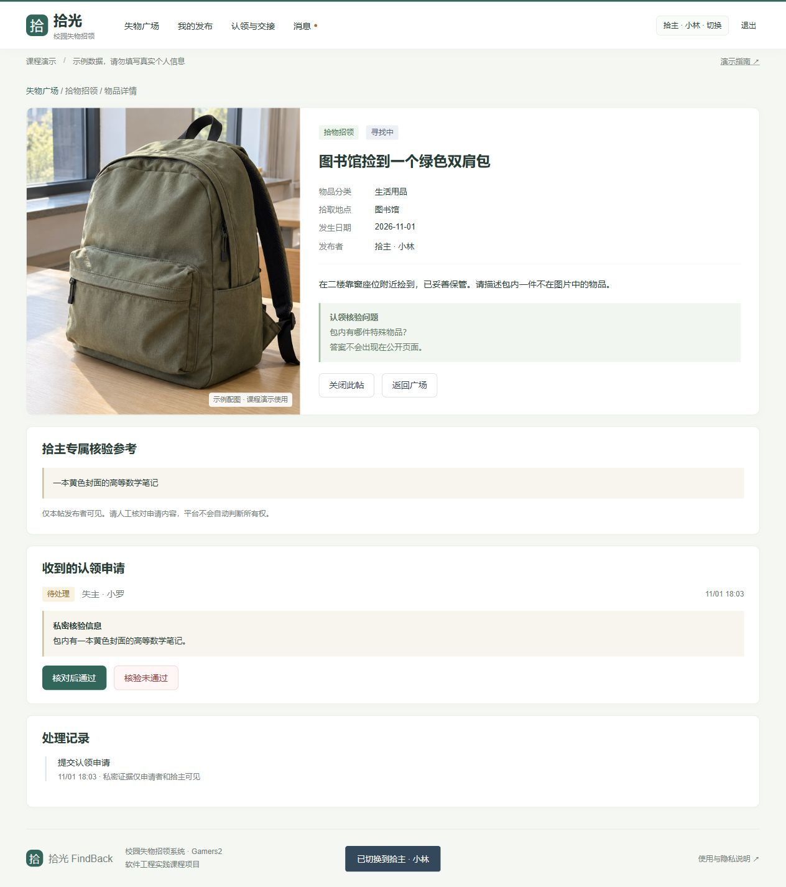
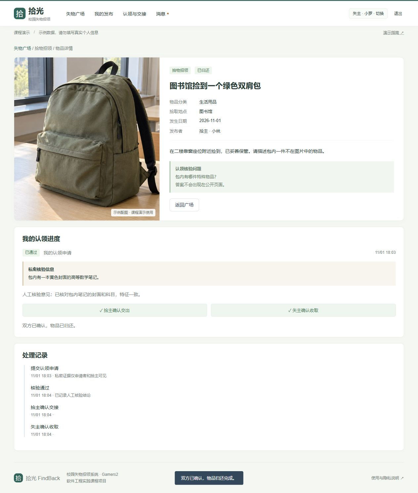
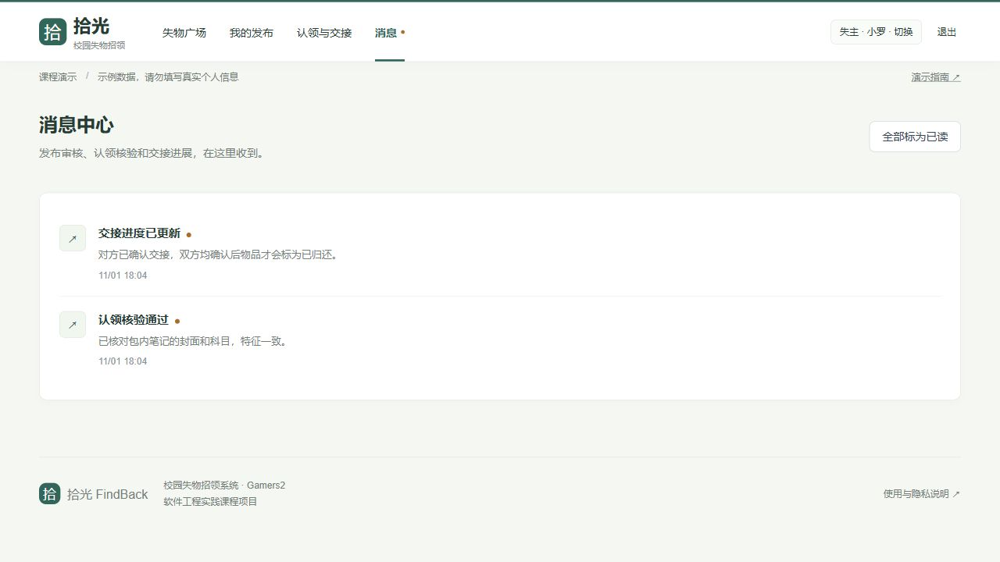

# Gamers2｜拾光 FindBack 原型设计

| 项目 | 内容 |
| --- | --- |
| 课程 | [EE308FZ Software Engineering 2026 Fall](https://bbs.csdn.net/forums/2601_MU_SE_FZU) |
| 作业要求 | [Prototype Design 作业说明](https://bbs.csdn.net/topics/620556488) |
| 团队 | Gamers2，课程第 4 组，14 名成员 |
| 项目 | 拾光 FindBack · 校园失物招领基础版 |
| 团队账号 | [Gamers_2](https://blog.csdn.net/2603_97191685) |
| 本次目标 | 使用专用原型工具设计可操作流程，展示设计过程、困难与解决情况，并形成答辩材料 |
| 原型工具 | 墨刀：正式页面内嵌 HTML 交互组件，使用模拟数据 |
| 截止时间 | 2026 年 11 月 1 日 23:59（教师通知） |

> 本文为提交前初版。真实讨论照片、成员具体完成情况和个人感受仍需团队补齐，公开源码与 PPT/PDF 地址已列在第 2 节。正文中的截图来自课程演示系统，物品与身份均为示例。

## 目录

[TOC]

## 1 项目延续与本次范围

本次继续做校园失物招领系统。原型包含发布、查找、认领申请、拾主核验和双方确认。先把这几个操作做完整，再考虑图像匹配等扩展功能。

早期需求规格说明书还规划了图像候选匹配、小程序和校园认证。本次先实现清晰、可验证的基础流程，没有把这些规划能力写成已经完成。图像匹配只应帮助发现候选物品，不能代替私密证据的人工判断。

本次还完成了前后端演示实现：浏览器页面通过 HTTP API 读写数据库。它用来验证原型中的状态和权限能否实际落地，不代表已经开展校园试点或完成原 SRS 的全部需求。

## 2 原型与附件入口

- **[打开墨刀交互原型，答辩主入口](https://modao.cc/proto/mZBdN92Gtntbi9MCoK4oiE/sharing?view_mode=device&screen=rbpVZhjdku4xrr7am&canvasId=rcVZhmZ6fw9Zfa16)**
- [墨刀编辑项目](https://modao.cc/proto/design/pb2mvxifnjjqt5ecl)：需要项目权限。
- [前后端演示站](https://findback-gamers2.x1013956.chatgpt.site)：当前账号私有，课堂优先演示上方墨刀原型或本地系统。
- **[下载 PPT（配图版·链接修正版）](https://github.com/Zarvik188/FindBack-Gamers2-Prototype/raw/refs/heads/main/deliverables/FindBack-Prototype.pptx)**：第 1、11 页可点击墨刀链接。
- [查看 PDF 备用稿](https://github.com/Zarvik188/FindBack-Gamers2-Prototype/blob/main/deliverables/FindBack-Prototype.pdf)。
- [GitHub 公共源码仓库](https://github.com/Zarvik188/FindBack-Gamers2-Prototype)；[全部源码 ZIP](https://github.com/Zarvik188/FindBack-Gamers2-Prototype/archive/refs/heads/main.zip)。

原型分享面板当前显示访问权限为“所有人”。墨刀原型使用独立模拟数据，刷新会重置；实际前后端使用持久化数据库，两者用途不同。墨刀的 HTML 组件支持导入页面并保留交互，设计源文件随源码一同归档，可参考[墨刀官方 HTML 导入说明](https://modao.cc/feature/html-editor/)。本次没有将所有控件转换成独立的墨刀原生图层。

## 3 用户角色与主流程

| 用户 | 主要任务 | 操作后应看到什么 |
| --- | --- | --- |
| 访客 | 浏览、搜索、筛选已公开的物品 | 结果列表、空结果说明和详情入口 |
| 失主 | 发布寻物、提交认领、确认收取 | 申请状态、核验结论与交接进度 |
| 拾主 | 发布拾物、核对私密证据、确认交出 | 本人发布、认领申请与确认状态 |
| 内容管理员 | 审核公开文字与图片 | 待审核内容、审核操作和通知反馈 |

正常认领流程为：浏览与筛选 → 查看物品详情 → 提交私密特征 → 拾主人工作出核验结论 → 双方交接 → 拾主确认交出、失主确认收到 → 已归还。

公开内容审核与认领核验使用不同状态。前者决定信息能否出现在广场，后者判断一次认领是否通过。只有一方确认时仍处于“交接中”；双方均确认，物品才进入“已归还”。

## 4 页面设计与交互细节

### 4.1 首页与搜索

首页右上方提供“发布寻物”和“发布招领”，下方是搜索与筛选；列表展示标题、地点、日期和业务状态。用户可组合关键词、信息类型、类别、地点和状态筛选，并用“清除筛选”回到完整列表。空结果提供明确提示，避免让用户误以为页面加载失败。

页面采用浅色背景、低饱和绿色按钮与图片卡片，首页保留搜索、筛选和发布入口，没有大幅宣传区。六件示例物品配有内置生图工具生成的示例图片，卡片和详情页均有标注，不代表真实失物照片；其他未上传照片的记录仍显示“暂无照片”。状态同时用文字说明。

### 4.2 物品详情与认领

详情公开物品的基本信息和核验问题，但不公开拾主的私密参考答案。申请者通过弹窗描述公开图片中看不到的细节。证据只对申请者与本帖拾主显示，后台内容审核不因此获得全部私密认领证据。

重复提交会被限制；申请提交后，按钮显示等待状态，页面保留申请进度。核验未通过时记录原因，申请者可以修正证据后重新申请。

### 4.3 发布与内容审核

发布页区分公开描述、核验问题和私密参考信息。文字字段有长度及日期校验，公开文本限制直接填写手机号；上传图片在前端压缩后提交，图片中的信息由管理员人工审核。提交后显示“待审核”，只有审核通过才进入公共列表。

这套检查不能保证自动识别所有个人信息，因此演示环境不使用真实证件或联系方式。审核意见会形成站内通知，让发布者知道下一步如何处理。

### 4.4 人工核验与双向交接

拾主可以看到本人保存的核验参考信息和申请者证据，并记录核验结论。通过后进入交接，不能直接将物品标为归还。界面分别显示“拾主确认交出”和“失主确认收取”，让双方知道还缺哪一步。

### 4.5 消息中心

新申请、审核结论和交接变化通过站内消息反馈，消息链接回到对应物品。通知按当前用户隔离，支持标记已读。本次没有接入微信、短信或邮件。

## 5 设计过程、困难与解决情况

| 问题 | 尝试与调整 | 当前结果与收获 |
| --- | --- | --- |
| 从完整 SRS 直接做原型，范围过大 | 先锁定基础版，将图像匹配和小程序留在后续迭代 | 主流程可独立演示，范围边界更清晰 |
| 容易把内容审核和认领核验混在一起 | 分别设计审核状态、认领状态和物品状态 | 页面和服务端采用一致的状态含义 |
| 核验答案出现在公共页面会失去验证作用 | 将公开问题、拾主参考答案、申请者证据拆开，并测试各角色读取权限 | 公开页面不返回参考答案，私密证据按角色隔离 |
| 单方点击就标记归还，无法反映真实交接 | 使用两个独立确认标记，后端检查双方状态 | 单方确认仍显示交接中，双方确认才归还 |
| 墨刀原生图层转换等待较长 | 使用官方 HTML 导入组件，并将组件放入正式页面后再打开分享预览 | 已验证分享预览中的身份切换、详情跳转和认领提交；原生图层转换未作为已完成成果 |
| 原型中的状态变化是否可实际保存 | 同步实现 HTTP API 与数据库，使用接口测试和浏览器操作验证 | 本地系统刷新后保留交接与发布记录；原型模拟数据刷新重置 |

## 6 前后端实现与验证

前端采用 HTML、CSS 和 JavaScript；本地后端采用 Node.js HTTP 服务、共享业务模块与 SQLite。云端部署复用同一业务模块，适配 Workers/D1。此基础版技术栈与早期 SRS 的 Java/Spring Boot 计划存在调整，后续应在团队评审后更新相应技术文档。

已实现账号登录、发布、筛选搜索、详情、认领、人工审核、双向交接、通知和内容审核。会话与权限在服务端检查，数据库使用参数绑定；密码带盐哈希保存。示例角色切换用于课堂演示，不代表校园身份认证。

验证结果：18 项接口测试全部通过，覆盖匿名与越权请求、私密字段隔离、审核后公开、重复认领、竞争申请只批准一条、双方确认、通知隔离、会话及数据库重开等情形。本地 D1 浏览器操作完成了认领至归还的全流程，并提交了一条笔袋信息，刷新后仍可读取。云端构建和发布成功，当前保持账号私有权限。

这些验证不包含真实校园用户研究、压力测试、图像匹配准确率或生产运行指标，不能据此宣称原 SRS 的性能目标已经达到。

## 7 团队分工、贡献与进度

### 7.1 本次分工与贡献比例

成员与角色沿用已有组队材料。本次贡献比例为：孙梓焜、罗钰涵、周胜东、吴浚嘉各 10%，其余 10 名成员各 6%，合计 100%。表中负责范围沿用原任务安排，成员具体完成情况由团队结合工作记录核实。

| 学号 | 成员 | 本次建议负责范围 | 贡献比例 |
| --- | --- | --- | --- |
| 832401315 | 孙梓焜 | 范围、排期、评审和交付汇总 | 10% |
| 832401313 | 罗钰涵 | 接口、部署与交付归档 | 10% |
| 832401329 | Zhou Debin | 角色场景与需求追踪 | 6% |
| 832401327 | Zheng Ziyang | 业务规则与异常路径 | 6% |
| 832401223 | 吴浚嘉 | 原型视觉和布局评审 | 10% |
| 832401328 | Zheng Zongyuan | 广场与搜索交互评审 | 6% |
| 832401230 | Zuo Xiangrong | 详情、认领交互评审 | 6% |
| 832401210 | Li Jianhang | 发布与消息交互评审 | 6% |
| 832401213 | Liu Peikun | 发布与内容审核接口评审 | 6% |
| 832401317 | Wang Qiushi | 认领与状态规则评审 | 6% |
| 832401318 | Xiao Zhengyu | 会话、通知和权限评审 | 6% |
| 832401212 | Liu Junye | 图像匹配后续范围与接口规划 | 6% |
| 832401319 | Xu Yichao | 正常流程和异常验收 | 6% |
| 832401330 | 周胜东 | 页面兼容、演示与材料一致性检查 | 10% |

贡献比例合计：4 × 10% + 10 × 6% = 100%。上述比例为本次作业口径，具体工作说明应与实际完成记录一致。

### 7.2 当前产物与提交安排

| 阶段 | 产物 | 当前状态 |
| --- | --- | --- |
| 范围整理 | 基础版流程、角色与能力边界 | 已形成，待团队评审 |
| 原型制作 | 墨刀交互组件与正式分享页面 | 已建立并进行操作验证 |
| 实现验证 | 前后端源码、数据库、18 项接口测试、实际页面截图 | 已形成 |
| 材料整理 | 本文、答辩 PPT/PDF 与演示操作说明 | 初版 |
| 提交前核实 | 成员具体完成情况、讨论照片、个人感受与课程提交 | 贡献比例与附件链接已填写；其余待补 |

建议协作时以“页面/流程、发现的问题、负责人、修订结果”为记录单位，博客和 PPT 使用同一份入口与能力清单。当前未提供可核实的团队会议、提交或评审记录，不能补写成已发生的协作历史。

## 8 讨论照片、感受与成员评价（提交前必补）

【插入本次真实、非摆拍的团队讨论照片，并说明讨论的具体问题、日期和地点。不要用系统截图或生成图片替代。】

例如，拾主点击了“交出物品”，失主还没有确认收到，这时应保留“交接中”。实际检查时还发现，双方已经确认后，一处旧提示仍写着等待完成，现已与物品状态统一。后续评审会继续检查核验失败、单方确认和重复申请等情况。

【以下内容由成员根据真实经历填写：各人解决了什么问题、参考了谁的意见、仍有什么不足，以及对其他成员工作的具体评价。上段是设计复盘，不是已收集的成员访谈或感受。】

## 9 答辩演示与提交检查

答辩时直接点击 PPT 中的墨刀链接：先浏览和筛选，再以失主身份申请认领，切换拾主核验，分别完成双方确认，最后查看消息。不要只展示截图。原型刷新会重置模拟数据，适合重新演练；本地实际系统的数据会保留。

提交前检查：原型链接在另一台电脑能打开；检查第 2 节 GitHub 公共仓库、PPT/PDF 与源码下载地址可免登录打开；真实讨论照片和个人完成情况已补齐，贡献比例与第 7 节一致；图片已上传到 CSDN 图床并替换本文相对路径；博客发布后检查目录、图片和链接。
